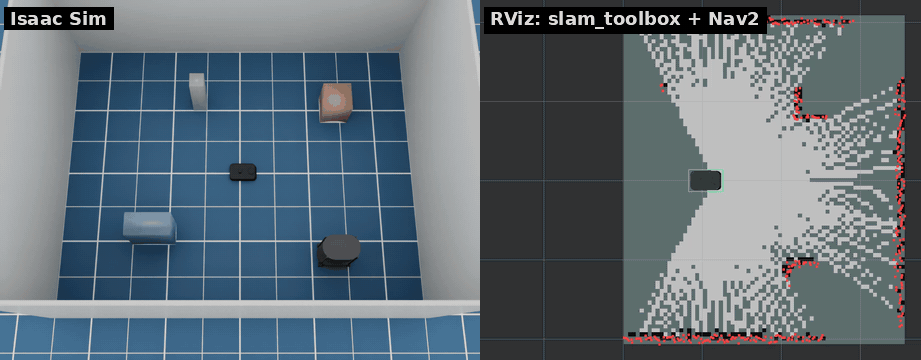

# kachaka_isaac_sim

[English](README.md)

家庭用ロボット [カチャカ](https://kachaka.life/) のシミュレータです。
NVIDIA Isaac Sim 6.1 上で動き、公式 [kachaka-api](https://github.com/pf-robotics/kachaka-api)
の ROS 2 ブリッジと同じインターフェースを持ちます。実機向けに書いたコード（`/kachaka` 以下の topic）を
そのままシミュレータに向けて動かせます。



*左: Isaac Sim、右: slam_toolbox と Nav2 を表示した RViz（2 倍速）*

## 特徴

- 公式 URDF とメッシュから変換したロボットモデル
- 車輪トルク制限とキャスター付きの差動二輪。手動の cmd_vel は実機ブリッジと同じ 0.3 m/s、自律走行はそれより速い（[速度上限](docs/ja/robot.md#速度上限)）
- センサー: 2D LiDAR、前後の RGB カメラ、ToF 深度カメラ、IMU
- オドメトリ（統合・車輪）、TF、`joint_states`、`robot_description`、バージョンのスタブ
- 充電器とバッテリー: 停止中も少しずつ、走行中はより速く、シェルフ運搬中はさらに速く減り、
  充電器の上では 80 % までは速く、そこから満充電まではゆっくり充電されます（[バッテリー](docs/ja/robot.md#バッテリー)）
- 実機と同じ前方障害物での自動停止。teleop・Nav2・kachaka-api のどこからの指令でも、障害物の手前で
  前進を止めます。スマホアプリと同じく OFF にできます
- 前後のトーチライト。実機と同じく kachaka-api で点灯します
- 前方カメラでの物体検出（人・シェルフ・充電器）。シーンの正解データから作ります
- 段差センサー: 段差で停止して一時停止します（実機と同じエラー 21051/21052）。
  本体の衝突は回数を数えて publish します。`--drop` で床に穴を開けられます
- topic 名・メッセージ型・QoS は実機ブリッジと同じ
- ワールド: カチャカシェルフを置いた壁付きの部屋、または Isaac Sim のシーン（office、hospital、warehouse、5 種類のキッチン）
  レイアウトファイルで充電器・シェルフ・ロケーション・人・箱・壁・ドアを配置（ランダム配置も可）。
  人と箱は経由点を巡回・範囲内を歩き回り・現れたり消えたりもできます
- シナリオランナー: Nav2 と kachaka-api のシナリオをヘッドレスでまとめて実行し、成功・時間・走行距離・衝突・
  障害物との最小距離・リカバリー回数を CSV/JSON で出力（[シナリオランナー](docs/ja/scenario_runner.md#シナリオランナー)）
- カチャカ向けに設定済みの slam_toolbox・Nav2・RViz・teleop を入れた Docker イメージ。
  カチャカには後方の距離センサーがないので、Nav2 は後退しない設定です
- 実機ブリッジの全コマンドに対応した `kachaka_command/execute`（Nav2 ベース）: MOVE_TO_POSE、
  MOVE_TO_LOCATION、RETURN_HOME、SPEAK（テキストのみ）、カチャカシェルフのコマンド
  （DOCK_SHELF、UNDOCK_SHELF、MOVE_SHELF、RETURN_SHELF）、移動コマンド（MOVE_FORWARD、
  ROTATE_IN_PLACE など）。`goal_pose` と自動充電にも対応
- ポート 26400 で [kachaka-api](https://github.com/pf-robotics/kachaka-api) の gRPC API を全 RPC 提供。
  公式の Python クライアント（`KachakaApiClient`）が実機なしで使えます
- Web ダッシュボード（既定では起動しない）: 地図上のロボット・シェルフ・充電器、ロボットの状態、
  コマンド送信ボタン。kachaka-api だけを使うので実機のカチャカにもつながります

## 動作環境

- Ubuntu 24.04、x86_64
- Isaac Sim 6.1 が対応する NVIDIA RTX GPU とドライバ（RTX 2080 Ti、ドライバ 595 で確認）
- [uv](https://docs.astral.sh/uv/)、Docker（Compose 付き）、git、約 40 GB の空きディスク

## クイックスタート

```bash
# 1. Isaac Sim 6.1 を .venv にインストール（ダウンロードが大きい）
uv sync

# 2. 公式のカチャカモデルを取得してロボットの USD を作る
uv run python scripts/fetch_assets.py
uv run python scripts/build_usd.py

# 3. シミュレータを起動（GUI。ウィンドウなしなら --headless）
scripts/run_sim.sh
```

`scripts/run_sim.sh` は `OMNI_KIT_ACCEPT_EULA=YES` を設定します。実行すると
[NVIDIA Isaac Sim のライセンス](https://docs.isaacsim.omniverse.nvidia.com/latest/common/NVIDIA_Omniverse_License_Agreement.html)
に同意したことになります。初回はシェーダのコンパイルで数分かかります。

別のターミナルで、ROS 2 のツールを Docker で動かします。

```bash
docker compose -f docker/compose.yaml build
xhost +local:            # コンテナから RViz のウィンドウを開けるようにする

# キーボードで操縦
docker compose -f docker/compose.yaml run --rm teleop

# slam_toolbox で地図を作る（NAV=true で RViz から Nav2 のゴールも送れる）
NAV=true docker compose -f docker/compose.yaml up slam

# 地図を保存し、その地図でナビゲーション
docker compose -f docker/compose.yaml run --rm shell \
    ros2 run nav2_map_server map_saver_cli -f /maps/map
docker compose -f docker/compose.yaml up navigation
```

コンテナはホストネットワークを使うので、同じマシンのシミュレータを DDS のディスカバリで見つけます。

### RViz の色

| 色 | 表示 | トピック |
|---|---|---|
| 赤い点 | LiDAR のスキャン | `/kachaka/lidar/scan` |
| 青い線 | Nav2 のグローバルプラン | `/plan` |
| 緑の枠 | ロボットのフットプリント | `/local_costmap/published_footprint` |
| 濃い灰色 / 青 | シェルフ / 牽引中のシェルフ | `/shelf_markers` |
| オレンジの円柱 / 茶色の箱 | 動く人 / 箱（ロボット待ちの間は赤）、緑の矢印は速度 | `/mover_markers` |
| 紫 / 黄色 / 薄い灰色のパネル | ドア 閉 / 開閉中 / 開 | `/door_markers` |
| 床の薄いオレンジの長方形 | 自動ドアのセンサ範囲 | `/door_markers` |

コストマップ（既定では非表示）は RViz の `costmap` 配色です。

## ドキュメント

- [ロボットの機能](docs/ja/robot.md): コマンド、前方障害物での停止、トーチライト、リセット、充電器とバッテリー、シェルフ、速度上限、物体検出、段差と衝突
- [ワールドとレイアウト](docs/ja/worlds.md): ドア、エレベーター、レイアウトファイル、動く人と箱
- [複数ロボット](docs/ja/multi_robot.md): 1 つのワールドに複数台のカチャカ、共通の地図で各台の Nav2
- [シナリオランナー](docs/ja/scenario_runner.md): Nav2 と kachaka-api のシナリオを指標付きでまとめて実行
- [シミュレータのオプション](docs/ja/simulator_options.md): コマンドラインオプション、センサーの劣化、Isaac Sim のシーン、地図からワールドを作る
- [ROS 2 インターフェース](docs/ja/ros2_interface.md): トピック、サービス、アクション
- [kachaka-api（gRPC）](docs/ja/kachaka_api.md): gRPC API、asyncio 版クライアント、地図、Web ダッシュボード、デモノートブック
- [性能](docs/ja/performance.md)
- [テスト](docs/ja/testing.md)
- [設計メモ（英語）](docs/design.md)

## ライセンス

Apache License 2.0。[LICENSE](LICENSE) と [NOTICE](NOTICE) を参照してください。
カチャカの開発元である Preferred Robotics, Inc. とは関係のない非公式プロジェクトです。

ロボットモデルは [pf-robotics/kachaka-api](https://github.com/pf-robotics/kachaka-api)（Apache-2.0）、
シェルフのモデルは [GAI-313/kachaka_shelf_description](https://github.com/GAI-313/kachaka_shelf_description)（MIT）
のものです。どちらも `scripts/fetch_assets.py` でダウンロードし、このリポジトリには含めていません。
