# kachaka_isaac_sim

[日本語](README.ja.md)

A simulator for the [Kachaka](https://kachaka.life/) home robot on
NVIDIA Isaac Sim 6.1, with the same ROS 2 interface as the official
[kachaka-api](https://github.com/pf-robotics/kachaka-api) bridge. Code written
for a real Kachaka (topics under `/kachaka`) runs against the simulator unchanged.


*Left: Isaac Sim. Right: RViz with slam_toolbox and Nav2 (2× speed).*

## Features

- Robot model converted from the official URDF and meshes.
- Differential drive with torque-limited wheels and casters; manual cmd_vel at the real bridge's 0.3 m/s, autonomous motion faster (see [Speed limits](#speed-limits)).
- Sensors: 2D LiDAR, front/back RGB cameras, ToF depth camera, IMU.
- Odometry (fused and wheel), TF, `joint_states`, `robot_description`, version stub.
- Charging dock and battery: the battery drains while driving and charges on the dock.
- Front obstacle stop, as on the real robot: forward motion brakes in front of an obstacle,
  from any source (teleop, Nav2, kachaka-api). It can be switched off, like in the smartphone app.
- Front and back torch lights, set through kachaka-api like on the real robot.
- Object detection (people, shelves, the charger) on the front camera, from the scene's ground truth.
- Step sensors: the robot stops and pauses at a drop (errors 21051/21052, as on the real robot);
  collisions of the body are counted and published. `--drop` cuts a hole in the floor.
- Same topic names, message types and QoS as the real bridge.
- Worlds: a walled room with a Kachaka Shelf, or Isaac Sim scenes (office, hospital, warehouse).
  Layout files place the charger, shelves, locations, people, boxes, walls and doors, optionally at random;
  people and boxes can walk routes, wander and come and go.
- A scenario runner: batches of Nav2 and kachaka-api scenarios, headless, with success, time,
  path length, collisions, clearance and recoveries per run, in CSV/JSON (see [Scenario runner](#scenario-runner)).
- Docker image with slam_toolbox, Nav2, RViz and teleop, set up for Kachaka.
  Nav2 never drives backwards, since Kachaka has no rear range sensor.
- `kachaka_command/execute` with every command type of the real bridge: MOVE_TO_POSE,
  MOVE_TO_LOCATION, RETURN_HOME, SPEAK (text only), the Kachaka Shelf commands
  (DOCK_SHELF, UNDOCK_SHELF, MOVE_SHELF, RETURN_SHELF) and the motion commands
  (MOVE_FORWARD, ROTATE_IN_PLACE, …), built on Nav2. Also `goal_pose` and auto homing.
- The [kachaka-api](https://github.com/pf-robotics/kachaka-api) gRPC API on port 26400,
  with every RPC, so the official Python client (`KachakaApiClient`) works without a robot.
- A web dashboard (off by default): the map with the robot, shelves and charger, the robot's
  state and command buttons, all through kachaka-api, so it also works with a real Kachaka.

### Commands

```bash
ros2 action send_goal /kachaka/kachaka_command/execute kachaka_interfaces/action/ExecKachakaCommand \
    "{kachaka_command: {command_type: 13, move_to_pose_command_x: 1.0, move_to_pose_command_y: 0.5,
      move_to_pose_command_yaw: 1.57}, cancel_all: true}"   # MOVE_TO_POSE_COMMAND
ros2 topic pub --once /kachaka/goal_pose geometry_msgs/PoseStamped \
    "{header: {frame_id: map}, pose: {position: {x: 1.0, y: 0.5}, orientation: {w: 1.0}}}"
```

| Command | What it does |
|---|---|
| MOVE_TO_POSE | Nav2 goal in the map frame |
| MOVE_TO_LOCATION | Nav2 goal to a location from `layout/locations/list`; the charger (`home`) runs RETURN_HOME |
| SPEAK | no audio: the text goes to the log and to `sim/speech` |
| MOVE_FORWARD, ROTATE_IN_PLACE | drives the distance or turns the angle on odometry; MOVE_FORWARD stops (−9) at an obstacle ahead |
| MOVE_BY_VELOCITY_WITH_MUTED_SENSORS | drives at the velocity for the duration, with the front obstacle stop muted |
| LOCK | holds the robot still for the duration |
| DOCK_ANY_SHELF_WITH_REGISTRATION | docks the shelf nearest to the location (within 0.5 m) |
| LOCALIZE | succeeds at once: the simulator never loses its pose |
| DEPART_FROM_CHARGER | drives 0.3 m off the charger; fails (−13) when not on it |

As on the real robot, `cancel_all: true` stops the running command; without
it a command waits until the earlier ones finish. `tts_on_success` is sent to
`sim/speech` after a successful command. `goal_pose` sends MOVE_TO_POSE
without `cancel_all`, like the real bridge.

### Front obstacle stop


The real Kachaka stops by itself when something is just in front of it; its
smartphone app turns this off. The simulator does the same for every velocity
command, whatever sends it (teleop, Nav2, `set_robot_velocity`, commands):

- Forward motion brakes when the LiDAR clearance ahead of the body, in a lane
  0.30 m wide, falls to `margin + v * scan period + v² / (2 * deceleration)`.
  At rest the robot keeps 3 cm (`front_stop.margin`). Turning and backing up
  stay allowed, and the robot drives on once the way is clear.
- The lane is narrower than a shelf's legs, so the robot still drives under a
  Kachaka Shelf; a towed shelf is not seen.
- MOVE_BY_VELOCITY_WITH_MUTED_SENSORS and MOVE_FORWARD with `mute_sensors`
  turn it off while they run. MOVE_FORWARD fails with −9 when the stop holds
  the robot for 1 s.
- `config/robot.yaml` (`front_stop`) sets the initial state and the zone. The
  app setting is not part of kachaka-api, so the simulator-only service
  `sim/front_stop/set_enabled` switches it at run time:

```bash
ros2 service call /kachaka/sim/front_stop/set_enabled std_srvs/srv/SetBool "{data: false}"
ros2 topic echo /kachaka/sim/front_stop/state   # {"enabled": false, "muted": false, "blocked": false}
```

The real stop distance and zone are not published; the values are estimates.
The LiDAR scans at 10.5 cm, so lower obstacles are not seen.

### Torch lights

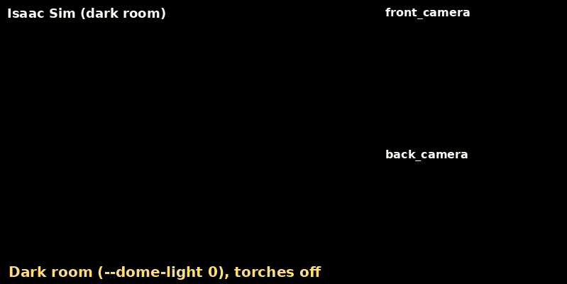

kachaka-api has a front and a back torch, set with `SetFrontTorchIntensity` /
`SetBackTorchIntensity` (0-255, 0 is off). Where the torches sit on the real
robot is not documented and the URDF has no frame for them, so the simulator
assumes they light the camera views: each is a spotlight at the front or back
camera, aimed along it.
The Python client has no wrapper for them, so call the gRPC stub:

```python
from kachaka_api import KachakaApiClient
from kachaka_api.generated import kachaka_api_pb2 as pb2

client = KachakaApiClient("127.0.0.1:26400")
client.stub.SetFrontTorchIntensity(pb2.SetFrontTorchIntensityRequest(intensity=255))
```

- The real robot has no RPC to read the levels back; the simulator publishes
  them on `sim/torch` (latched JSON `{"front", "back"}`).
- The default scenes are bright, so the torches barely show. `--dome-light 0`
  turns the ambient light off in the default room (Isaac Sim scenes bring
  their own lights).
- Brightness, beam and colour are guesses (`torch` in `config/robot.yaml`).

### Resetting the simulator

`sim/reset` (simulator only) puts everything back to the start without
restarting the simulator:


```bash
ros2 service call /kachaka/sim/reset std_srvs/srv/SetBool "{data: false}"   # data: true also clears the SLAM map
```

- The robot goes back to its spawn pose at rest, a towed shelf is let go and
  every shelf goes back home.
- The SLAM map and the map frame stay valid: the odometry sees the jump back
  as an exact move. With `data: true` slam_toolbox starts a new map and the
  odometry starts again at zero.
- The battery goes back to its initial level, the torches go off, the
  emergency stop is released and the front obstacle stop goes back to its
  setting in `config/robot.yaml`.
- `command_server` drops the running and queued commands without a result,
  clears the costmaps and goes back to its parameters (auto homing).
- The gRPC server forgets the command history, the last result, the errors,
  added sounds and the speaker volume. Under `navigation.launch.py` it also
  tells AMCL the robot is back at the start.
- For 1 s after the reset the robot ignores `cmd_vel`, so a controller that
  is still sending cannot drive it off again.

The ROS checks under `tests/` reset first (`--no-reset` skips it,
`--clear-map` also clears the map); `python3 /tests/sim_reset.py` resets on its own.

### Returning to the charger


*RETURN_HOME (2× speed). Nav2 drives to a point in front of the charger, then the robot backs onto it, as the real one does.*

```bash
ros2 action send_goal /kachaka/kachaka_command/execute kachaka_interfaces/action/ExecKachakaCommand \
    "{kachaka_command: {command_type: 8}}"   # RETURN_HOME_COMMAND
```

This needs the ROS 2 stack with Nav2 (`NAV=true ... up slam`, or `up navigation`),
which runs `command_server`. The robot leaves the charger with any Nav2 goal.
Battery rates and the charger's size are estimates (`config/robot.yaml`).

### Carrying a shelf

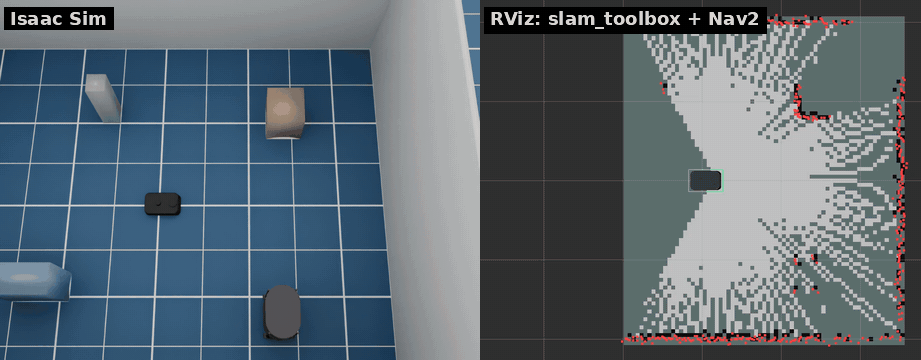

*DOCK_SHELF, then MOVE_SHELF to another location and UNDOCK_SHELF (3× speed).*

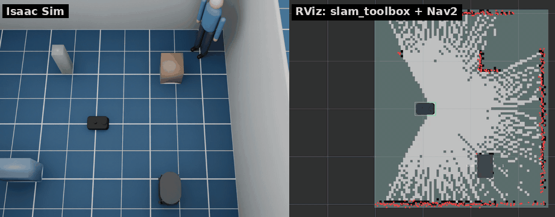

*RETURN_SHELF from there: Nav2 plans around the parked shelf, which is in the costmaps as a whole (the LiDAR sees only its legs).*

The room has one Kachaka Shelf (`S01`, home location `S01_home`) and one other
location (`L01`). The robot drives in under a shelf forward, raises its pin and
tows the shelf on its casters (≤ 0.5 m/s, see [Speed limits](#speed-limits)).
Nav2's footprint grows to the shelf's while towing.
Undocking lowers the pin and drives forward out of the shelf; it fails if
something blocks the way.

```bash
ros2 action send_goal /kachaka/kachaka_command/execute kachaka_interfaces/action/ExecKachakaCommand \
    "{kachaka_command: {command_type: 1, move_shelf_command_target_shelf_id: S01,
      move_shelf_command_destination_location_id: L01, move_shelf_command_undock_on_destination: true}}"   # MOVE_SHELF_COMMAND
```

| Command | What it does |
|---|---|
| DOCK_SHELF | docks with the shelf in front of the robot (within 1.5 m) |
| UNDOCK_SHELF | puts the towed shelf down and drives out forward |
| MOVE_SHELF | docks with the shelf if needed, tows it to a location, optionally undocks |
| RETURN_SHELF | MOVE_SHELF to the shelf's home location, then undocks |
| RETURN_HOME | returns a towed shelf home first, then docks with the charger |

Shelves are listed on `layout/shelves/list` and their homes on
`layout/locations/list`. Place shelves with `--shelf X Y YAW`. The shelf lands
where SLAM puts the location, a few centimetres off the world.
`robot_description` is the robot alone, as on the real Kachaka; RViz draws the
shelves from `/shelf_markers` (MarkerArray, published by `shelf_markers`).

### Speed limits

| | Alone | Towing a shelf |
|---|---|---|
| Manual: `manual_control/cmd_vel`, `set_robot_velocity` | 0.3 m/s | 0.3 m/s *(assumed)* |
| Autonomous: Nav2, kachaka-api commands (`sim/autonomous/cmd_vel`) | 0.8 m/s *(est.)* | 0.5 m/s *(est.)* |
| Turning (both) | 1.57 rad/s | 1.57 rad/s (Nav2: 0.98 rad/s) |

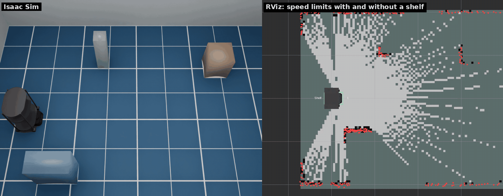

The real bridge scales manual cmd_vel to 0.3 m/s and 1.57 rad/s. The
Kachaka spec gives a top speed of 0.8 m/s alone and 0.5 m/s with a shelf;
the simulator uses these for autonomous motion until they are measured on a
real robot (#4). Whether the real robot also lowers the manual cap while
towing is not known, and the 0.5 m/s towing cap is above 0.3 m/s anyway.

Autonomous motion reaches the simulator on the simulator-only topic
`sim/autonomous/cmd_vel`: `nav_bridge` forwards Nav2's `/cmd_vel` there when
`use_sim_time` is true (to `manual_control/cmd_vel` for a real robot), and
`command_server` drives MOVE_FORWARD, ROTATE_IN_PLACE and the like on it.
Anything published on `manual_control/cmd_vel` stays at 0.3 m/s. While a shelf
is docked, `command_server` also sends Nav2's controller a 0.5 m/s
`speed_limit` (MPPI scales its turn rate with it, 1.57 → 0.98 rad/s) and
lifts it after undocking. The caps are `drive.max_linear_vel`,
`drive.max_linear_vel_auto` and `drive.max_linear_vel_towing` in
`config/robot.yaml`; `tests/speed_limit_check.py` measures them.

### Object detection

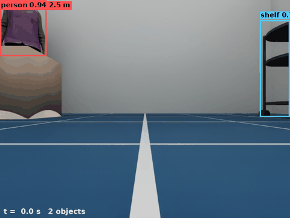

*`scripts/detection_demo.py`: one turn in place, drawn from `GetObjectDetection` and the front camera image.*

The real robot runs a detector network on the front camera. The simulator
takes the objects from the renderer instead: every pixel's instance id and
distance tell which person, shelf or charger it shows. An object is detected
from its visible pixels only, so a box in front of a person cuts the person's
bounding box, as it would for a real detector.

- `roi`: box around the visible pixels, in front camera pixels (640×480), with ±2 px noise.
- `distance_median`: median distance of the visible pixels.
- `score`: grows with the visible area (0.5 at 150 px, 0.95 from 20000 px), with a little noise.
- Nothing farther than 5 m or smaller than 150 px; 2 % of objects are missed in each frame.
- The results come with every front camera image (10 Hz) and carry its stamp.

The real detector's range, scores and miss rate are not published; these
numbers are guesses (`object_detection` in `config/robot.yaml`). Doors are
not detected.

`GetObjectDetectionFeatures` returns feature maps of each front camera image
in the shapes the robot's detector gives, which are the inputs of the
`predictor.onnx` that
[kachaka-transfer-learning](https://github.com/pf-robotics/kachaka-transfer-learning)
trains: `p4_out` (1×96×14×25), `p5_out` (1×96×7×13) and `p6_out` (1×96×4×7).
The robot's network is not published, so they come from a different one:
torchvision's ImageNet MobileNetV3-Large on the image resized to 224×398, its
stride 16 and 32 blocks projected to 96 channels by a fixed random 1×1
convolution, and a stride-2 max pool for `p6_out`
(`kachaka_isaac_sim/detection_features.py`). The names are assumed from the
demo notebooks, which strip `_out` to get the ONNX inputs. A head trained on
the simulator's features works in the simulator, not on the robot, and the
other way round. The first call downloads the weights (22 MB) into the torch
hub cache; `api.detection_features: false` in `config/robot.yaml` turns the
features off (empty, as before).

The room has two people (`people.room` in `config/robot.yaml`): Isaac Sim's
bundled characters (`people.characters`, standing still with the arms down).
Without the asset server they are capsule mannequins. `--person X Y YAW` places
others and `--no-people` removes them. The Isaac Sim scenes have none by default.

The LiDAR and Nav2 see a person by their colliders
([`legs.py`](kachaka_isaac_sim/legs.py)): a capsule for each thigh and shin,
0.13 m across (assumed), and an invisible box over the upper body from 0.75 m
up (0.28 × 0.5 m). The LiDAR scans 0.105 m above the floor, so a person shows as
two small arcs 0.2 m apart, the shins. A walking person's legs swing with the
gait: the arcs swap front and back, and a leg lifted in its swing drops out of
the scan for a moment. Sizes scale with `people.height`.

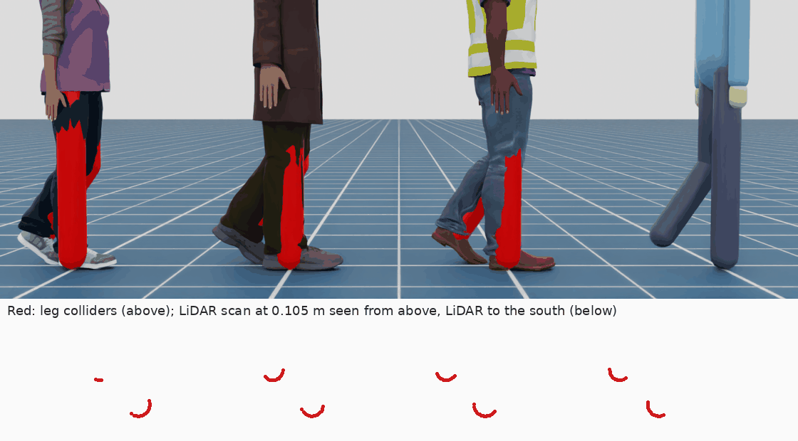

The results are on `GetObjectDetection` and on the real bridge's ROS 2 topic
`/kachaka/object_detection/result` (`kachaka_interfaces/ObjectDetectionListStamped`).
The simulator publishes JSON on `sim/object_detection` and
`object_detection_relay` in `bridge.launch.py` converts it.

### Steps and collisions

The real Kachaka has two step sensors at the front. When one sees no floor,
the robot stops, cancels its command and pauses with errors **21052 "Step
detected"** and **21051 "Kachaka is paused"** until its power button is pressed.
The simulator does the same:

- Two downward rays just ahead of the front casters (positions and range assumed,
  `cliff` in `config/robot.yaml`) check the floor every physics step (120 Hz).
- At a new drop the wheels stop at once, all commands are cancelled, velocity
  commands are ignored and `GetError` lists `[21051, 21052]`. New commands fail with 21051.
- The power button is `sim/power_button` (`std_srvs/Trigger`); kachaka-api `RestartRobot`
  and `sim/reset` also resume. While a sensor still looks over the edge, forward motion
  stays blocked; backing up and turning are allowed.

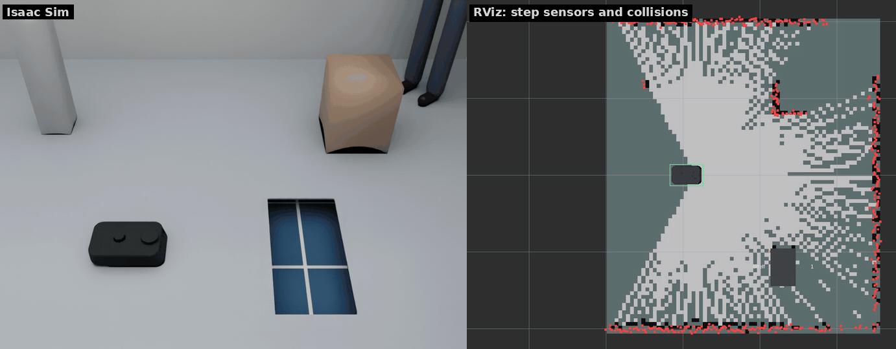

The built-in worlds are flat. `--drop X Y SX SY` cuts an SX × SY m hole centred
at (X, Y) into the floor, 0.15 m deep (`drop.depth`); repeat it for more:

```bash
scripts/run_sim.sh --drop 1.0 0.0 0.4 0.8   # a drop 0.8 m east of the spawn pose
ros2 topic echo /kachaka/sim/cliff          # {"enabled": true, "paused": true, "over": [true, true]}
ros2 topic echo /kachaka/sim/errors         # [21051, 21052]
ros2 service call /kachaka/sim/power_button std_srvs/srv/Trigger
```

No bumper is published for the real robot, so collisions do not stop it by
default: PhysX contact reports of the body (not the wheels or casters, nor the
floor) are counted, and each collision is published on `sim/collision` as
`{"stamp", "count", "with", "pose"}`, e.g. for scenario metrics. Contact with
the same object counts again after 0.5 s without contact. `collision.stop: true`
makes a collision stop the robot like a step, with the simulator error -18,
until the power button (assumed behaviour). `sim/reset` sets the count back to zero.

### Doors

`--door X Y YAW` puts a door into a doorway centred at (X, Y); the doorway
runs along YAW (x along the wall). The doorway's walls are separate:
`--wall X0 Y0 X1 Y1` adds a wall segment (both repeatable). A door is a
kinematic panel: the LiDAR sees it, Nav2 marks it in the costmap and plans
round it while it is closed, and it pushes whatever stands in its way (no
safety sensor stops it).

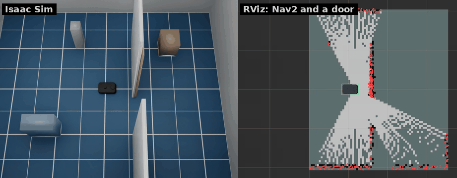

- `--door-kind sliding|hinged` (`door.kind`): a sliding panel runs along the wall,
  a hinged one swings 90° about the doorway's −x side.
- `--door-width` (0.8 m), `--door-closed` (start closed), `--door-cycle OPEN_S CLOSED_S`
  (open and close on a fixed cycle until the first command). Speeds, thickness and
  height are in `door` in `config/robot.yaml`.
- Doors are named D01, D02, ... in the order given. `sim/doors/<id>/set_open`
  (`std_srvs/SetBool`) opens or closes one; `sim/doors` (latched JSON) lists each door's
  `id`, `kind`, `pose` (map frame), `width`, `state` (open, closed, opening, closing),
  `opening` (0-1), `cycling` and `panel` (`pose` of the panel's centre in the map frame and
  `size` [length, thickness, height]). It is sent when a state changes and every 0.1 s while a
  panel moves. `sim/reset` puts the doors back to their start state.
- RViz draws the panels from `/door_markers` (MarkerArray, published by `door_markers` from
  `sim/doors`): violet closed, yellow opening or closing, faint grey open, with the id and
  state ([RViz colours](#rviz-colours)).

**Automatic doors** (#63) open by themselves, as in many offices, shops and hospitals:
`auto: true` on a layout door, or `--door-auto` for the `--door` doors. An automatic
door is a sliding door with a sensor area on both sides of the doorway: a rectangle
`width + 2 * margin` along the wall and `range` deep on each side. The door opens while
the robot (ground truth) or a moving person or box ([Moving people and boxes](#moving-people-and-boxes))
is in the area, stays open for `hold` s after the area clears, and opens again if
something comes in while it is closing.


- Settings are in `door.auto` in `config/robot.yaml`: `range` 1.0 m, `margin` 0.3 m,
  `hold` 2.0 s (real door sensors, microwave or infrared, differ by product; these
  are assumed) and `movers` (true: moving people and boxes open it too). A layout
  door can override them: `auto: {range: 1.5, hold: 3.0, movers: false}`.
- An automatic door can't be hinged or have a `cycle`.
- `sim/doors/<id>/set_open` still forces it open or closed; from then on the sensor is
  ignored until `sim/reset`. `sim/doors` has `auto` (true while the sensor drives the
  door) and, for an automatic door, `sensor` (`size` [along the wall, across] of the
  area, centred on the doorway).
- RViz shows the sensor area as a faint orange rectangle on the floor and adds
  "(auto)" to the door's label.
- Nav2 sees a closed automatic door as an obstacle like any other door, so it can't
  plan through it while it is closed: a goal on the other side of the only doorway can
  fail until the robot is near enough for the door to open (not tested). Send the robot up to the door first,
  as `tests/ros_auto_door_check.py` does.

```bash
# A wall at x = 0.6 with a door at y = -0.6 and a gap at the north end (layouts/room_door.yaml)
scripts/run_sim.sh --no-shelves --no-people --wall 0.6 -2.0 0.6 -1.0 --wall 0.6 -0.2 0.6 1.2 --door 0.6 -0.6 1.5708
scripts/run_sim.sh --layout layouts/room_door.yaml   # the same
ros2 service call /kachaka/sim/doors/D01/set_open std_srvs/srv/SetBool "{data: false}"
ros2 topic echo /kachaka/sim/doors   # {"doors": [{"id": "D01", "state": "closing", ...}]}
# The same wall without the gap and an automatic door (layouts/room_auto_door.yaml)
scripts/run_sim.sh --layout layouts/room_auto_door.yaml
```

### Elevator

A layout with `floors` and an `elevator` builds the room once per floor,
side by side 10 m apart along x (floor k's poses are the first floor's plus
k × 10 m), each with the same elevator car behind a doorway in a wall. The
car has a sliding door on each floor. `sim/elevator/go` (`std_msgs/String`,
a floor name) calls the car: the door closes, the car waits `ride` seconds per
floor, and whatever is in the car (the robot, a shelf) is moved to the other
floor's car; then the door opens there. The odometry does not see the move.
The door reopens while the robot is in the doorway, like a door sensor.
`sim/elevator` (latched JSON) gives `floors`, `floor` (where the car is),
`target`, `state` (open, closing, riding, opening), `door`, `robot_floor` and
`robot_in_car`; `sim/reset` sends the car back to its start floor. Each
floor has its own floor tint and its name written on the floor (visual
only; the sensors do not see them), so a ride shows in the viewport.

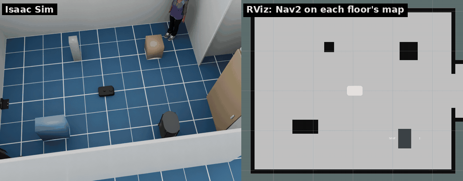

```bash
python3 scripts/make_maps.py layouts/elevator.yaml   # maps/elevator_1F.yaml, maps/elevator_2F.yaml
scripts/run_sim.sh --layout layouts/elevator.yaml
ros2 launch kachaka_sim_bringup navigation.launch.py map:=/maps/elevator_1F.yaml
ros2 topic pub --once /kachaka/sim/elevator/go std_msgs/msg/String "{data: 2F}"
ros2 topic echo /kachaka/sim/elevator   # {"floor": "2F", "state": "open", "robot_floor": "2F", ...}
```

Each floor navigates on its own saved map. `scripts/make_maps.py` draws them
from the layout (walls, the car, standing boxes; doors open). Each floor's
map frame is the spawn pose moved to that floor, so a pose in the car reads
the same on every floor's map. After a ride, load the next floor's map
with the robot's map pose from before the ride (TF `map` → `base_footprint`;
`/amcl_pose` is only sent after 0.25 m or 0.2 rad of motion, so it can lag):
kachaka-api `SwitchMap` with
`initial_pose`, or `sim/map/load` with `"pose"`. command_server loads the
map, gives AMCL the pose and answers once AMCL holds it, heading included
(AMCL starts over on a new map, so an `/initialpose` sent on its own can be
lost). `tests/ros_elevator_check.py`
drives into the car on 1F, rides to 2F, switches the map and drives to a goal
on 2F.

How the real Kachaka rides depends on the building's system. In a trial by
Mitsubishi Electric Building Solutions and Preferred Robotics, Kachaka asks
the building's platform (Ville-feuille), which calls the car, registers the
floor and tells Kachaka which car to take and when to board and leave
([press release, 2024-09-28](https://www.excite.co.jp/news/article/Prtimes_2024-09-28-115855-30/)).
At Toda Corporation's TODA BUILDING, Kachaka Pro carries mail between floors
by elevator, through a system Toda built on the public API
([LOGISTICS TODAY, 2026-07-17](https://www.logi-today.com/978771)).
kachaka-api has no elevator calls, so `sim/elevator/go` is sim-only, and the
car's size (1.4 × 1.4 m), door (0.9 m) and timing are assumed (`elevator` in
`config/robot.yaml`).

#### Stacked floors

With `stack: vertical` in the `elevator` entry the floors stand one above
the other, 3 m apart (assumed), and the car's floor is a platform that
carries the robot (and a shelf) up the shaft during the ride: nothing is
teleported. The layout is written as before (floor k at x + k × 10 m), so
the same saved maps fit, and each floor's map frame is the spawn pose at the
same x, y. `sim/elevator` adds `stack` and `robot_z` (height above the
first floor). Upper floors may not have doors or moving people and boxes,
and the car's yaw must be a multiple of 90°.


```bash
python3 scripts/make_maps.py layouts/elevator.yaml
scripts/run_sim.sh --layout layouts/elevator_vertical.yaml
ros2 launch kachaka_sim_bringup navigation.launch.py map:=/maps/elevator_1F.yaml
```

### Layout files

`--layout FILE` reads a YAML file that says where the robot starts and where
the charger, shelves, locations, people, boxes, walls, doors and drops are, on
top of any world. Examples are in [`layouts/`](layouts): `room.yaml`,
`room_door.yaml` and `room_auto_door.yaml` (the door setups above), `room_movers.yaml` (see
[Moving people and boxes](#moving-people-and-boxes)), and `office.yaml`, `hospital.yaml`,
`warehouse.yaml`, `simple_room.yaml` for the Isaac Sim scenes.

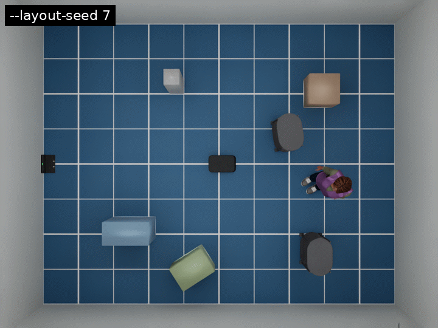

```yaml
world: room                 # --world overrides it
seed: 7                     # for the ranges below
clearance: 0.15             # m kept between randomised objects (default 0.1)
spawn: [0.0, 0.0, 0.0]      # x, y, yaw (m, rad)
charger: [-2.27, 0.0, 0.0]  # null: no charger
shelves:
  - {id: S01, name: Shelf 1, pose: [1.3, -1.2, 0.0]}
  - {id: S02, name: Shelf 2, pose: [[0.6, 2.0], [0.3, 1.5], [-0.3, 0.3]]}  # ranges
locations:
  - {id: L01, name: Kitchen, pose: [0.5, 1.0, 1.5708]}
people: [[2.0, 1.5, -2.5]]
boxes:
  - {name: crate, pose: [0.2, -1.6, 0.4], size: [0.5, 0.35, 0.45], color: [0.45, 0.55, 0.35]}
walls: [[0.6, -2.0, 0.6, -1.0]]              # x0, y0, x1, y1
doors:
  - {pose: [0.6, -0.6, 1.5708], kind: sliding, width: 0.8, open: true, cycle: [10, 5]}
  - {pose: [0.6, 1.0, 1.5708], auto: true}    # automatic: opens when the robot comes near
drops: [[1.0, 0.0, 0.4, 0.8]]                # x, y, size x, size y
```

- A key that is left out keeps the world's default (the room has a charger, a
  shelf, a location and two people); a key that is given replaces it, so
  `shelves: []` means no shelves and `charger: null` no charger.
- Any number in a pose can be a range `[lo, hi]`, drawn with the seed. A
  randomised object is drawn again until it keeps `clearance` from the other
  objects (and, in the room, from its walls). `--layout-seed N` overrides the
  file's seed; with neither, a seed is picked and printed
  (`[kachaka] layout layouts/room.yaml (seed 7)`), so a run can be repeated.
- Shelves and locations go to kachaka-api (`GetShelves`, `GetLocations`) and the
  dashboard, so `MOVE_TO_LOCATION` and the shelf commands use them.
- Command-line options still apply: `--shelf`, `--charger`, `--person`, the
  `--no-*` options and `--x/--y/--yaw` replace the layout's; `--wall`, `--door`
  and `--drop` add to them.
- After the start, the simulator checks each object for overlaps with the
  scene and prints `[kachaka] layout warning: ...` for one that is placed into a
  wall or furniture.

```bash
scripts/run_sim.sh --layout layouts/room.yaml --layout-seed 3
scripts/run_sim.sh --layout layouts/office.yaml   # also sets --world office
```

### Moving people and boxes

People and boxes in a layout file can move. Each moving one is a kinematic body
moved every physics step, so the LiDAR, the cameras, the ToF camera and object
detection see it where it is. Nothing moves unless a layout asks for it;
[`layouts/room_movers.yaml`](layouts/room_movers.yaml) is an example.


```yaml
people:
  - {pose: [0.8, -1.6, 1.5708], route: [[0.8, 1.6]], pause: 2.0}   # there and back
  - {pose: [0.0, 1.2, 0.0], wander: [[-0.1, 0.2], [0.6, 1.6]], speed: 0.5}  # x range, y range
boxes:
  - {name: cart, pose: [-1.6, -0.3, 0.0], size: [0.5, 0.4, 0.8],
     route: [[-0.5, -0.3]], speed: 0.3, pause: 3.0, appear: [25, 8]}
```

- `route`: waypoints walked in turn, then back to the start, over and over.
  `wander`: random points inside an area, drawn with the layout's seed. Not both.
- `speed` (m/s; default `movers.person_speed` 0.7 and `movers.box_speed` 0.4 in
  `config/robot.yaml`), `pause` (s at each waypoint), `appear: [present, away]`
  (s; there for a while, then gone, starting at a point of the cycle drawn with
  the seed).
- A mover turns towards its next waypoint, then walks. It waits while the robot
  is right in its way, and does not appear on top of the robot. After waiting
  `movers.give_way` s (3) it turns back to its last waypoint, or wanders
  elsewhere: the robot may be unable to leave with someone so close. Nothing
  else stops it: the robot has to keep out of its way.
- People swing their legs (the leg colliders too) and characters their arms as they walk.
- `sim/reset` puts them back at the start.
- Their ground truth is on `sim/movers` (simulator only, at the ground truth's
  20 Hz): JSON with, for each mover, `id`, `path` (USD prim), `kind` (`person`
  or `box`), `present`, `pose` [x, y, yaw] in the world frame (as
  `sim/ground_truth`) and `map_pose` in the map frame (both `null` while it is
  away), `velocity` [vx, vy] (world frame), `radius` (footprint), `size`
  [x, y, z], `blocked` (waiting for the robot) and `gap` (m between its
  footprint circle and the robot's body); then `closest`, the mover nearest the
  robot. Doors are not movers: they have `sim/doors` ([Doors](#doors)).
- RViz draws them from `/mover_markers` (MarkerArray, published by
  `mover_markers` from `sim/movers`): a person as an upright cylinder, a box
  as a box, with its name and an arrow for its velocity; red while it waits.

```bash
scripts/run_sim.sh --layout layouts/room_movers.yaml
python3 /tests/ros_nav_check.py --no-collisions   # with SLAM + Nav2: goals, no collisions, closest mover
ros2 topic echo /kachaka/sim/movers   # {"stamp": 12.3, "frame_id": "world", "movers": [...], "closest": {"id": "P01", "gap": 0.41}}
```

### Scenario runner

`scripts/run_scenarios.py` runs scenarios headless and in batches and reports
numbers, to compare parameter changes. A scenario file
([`scenarios/`](scenarios)) gives the world or a layout file (and any layout
key over it: spawn, shelves, people, …), the steps (Nav2 goals, kachaka-api
calls, waits), the number of runs and the seed:

```yaml
layout: ../layouts/room_movers.yaml
repeat: 3
steps:
  - goal: [1.6, -0.3, 3.1416]          # Nav2 NavigateToPose, world frame
  - api: move_shelf                    # any KachakaApiClient method
    args: {shelf_name_or_id: S01, location_name_or_id: L01}
  - api: move_to_pose                  # x, y, yaw in the world frame
    args: {x: 0.0, y: 0.0, yaw: 0.0}
  - wait: 2.0
```

```bash
python3 scripts/run_scenarios.py scenarios/room_nav.yaml scenarios/room_movers.yaml scenarios/room_api.yaml
python3 scripts/run_scenarios.py scenarios/room_movers.yaml --nav2-params my_nav2.yaml --label tuned
python3 scripts/run_scenarios.py --report build/scenarios/*/     # earlier batches side by side
```

For each scenario it starts the simulator (`run_sim.sh --headless` with the
scenario's layout) and SLAM + Nav2 in the ROS image, runs the steps once per
run (`sim/reset` and a cleared SLAM map in between), and tears both down;
`restart: true` starts afresh for each run instead, with seed + run.
`--nav2-params` swaps in another Nav2 parameter file. `--backend fake` uses
`scripts/fake_sim.py` instead of Isaac Sim (no GPU; the default room only,
without people or boxes), as CI does with `scenarios/fake_room.yaml`.

Per run: success (every step; a goal or move_to_pose step must also end within
0.35 m by ground truth), sim time, path length (ground truth), collisions
(`sim/collision`, with what), the smallest clearance between a LiDAR point and
the body's outline, and Nav2 recoveries (NavigateToPose feedback, also for
kachaka-api moves). The results go to `build/scenarios/<date>[-label]/`:
`runs.csv`, `runs.json` (with each step), `summary.csv`, `summary.txt` and the
logs. Time and path are averaged over the successful runs:

```
scenario     success  time [s]     path [m]      collisions  min clear [m]  recoveries
-----------  -------  -----------  ------------  ----------  -------------  ----------
room_nav     3/3      48.8 ± 0.5   10.97 ± 0.13  0 (0 runs)  0.113          0.0
room_movers  2/3      52.8 ± 1.1   11.09 ± 0.04  0 (0 runs)  0.011          6.7
room_api     2/2      111.8 ± 2.0  15.71 ± 0.36  0 (0 runs)  0.000          1.0
```

One batch on an RTX 2080 Ti host. The failed room_movers run never left the
start: the planner found no path to the first goal while a person crossed in
front, and gave up after 20 recoveries. Under a shelf (move_shelf,
return_shelf) the clearance is about 0, since the shelf's legs are next to the
body until it is docked; `runs.json` has the clearance and recoveries per step.

## Requirements

- Ubuntu 24.04, x86_64
- NVIDIA RTX GPU and driver supported by Isaac Sim 6.1 (tested on an RTX 2080 Ti, driver 595)
- [uv](https://docs.astral.sh/uv/), Docker with Compose, git, and about 40 GB of disk

## Quick start

```bash
# 1. Install Isaac Sim 6.1 into .venv (large download)
uv sync

# 2. Fetch the official Kachaka description and build the robot USD
uv run python scripts/fetch_assets.py
uv run python scripts/build_usd.py

# 3. Start the simulator (GUI; add --headless for no window)
scripts/run_sim.sh
```

`scripts/run_sim.sh` sets `OMNI_KIT_ACCEPT_EULA=YES`. By running it you accept
the [NVIDIA Isaac Sim license](https://docs.isaacsim.omniverse.nvidia.com/latest/common/NVIDIA_Omniverse_License_Agreement.html).
The first start compiles shaders and takes a few minutes.

In another terminal, run the ROS 2 tools in Docker:

```bash
docker compose -f docker/compose.yaml build
xhost +local:            # allow RViz windows from containers

# Drive with the keyboard
docker compose -f docker/compose.yaml run --rm teleop

# Build a map with slam_toolbox (add NAV=true to also send Nav2 goals from RViz)
NAV=true docker compose -f docker/compose.yaml up slam

# Save the map, then navigate on it
docker compose -f docker/compose.yaml run --rm shell \
    ros2 run nav2_map_server map_saver_cli -f /maps/map
docker compose -f docker/compose.yaml up navigation
```

The containers use host networking, so they find the simulator on the same
machine through DDS discovery.

### RViz colours

| Colour | What | Topic |
|---|---|---|
| Red dots | LiDAR scan | `/kachaka/lidar/scan` |
| Blue line | Nav2's global plan | `/plan` |
| Green outline | robot footprint | `/local_costmap/published_footprint` |
| Dark grey / blue | shelf / towed shelf | `/shelf_markers` |
| Orange cylinder / brown box | moving person / box (red while waiting for the robot), green arrow for its velocity | `/mover_markers` |
| Violet / yellow / faint grey panel | door closed / opening or closing / open | `/door_markers` |
| Faint orange rectangle on the floor | an automatic door's sensor area | `/door_markers` |

The costmaps (off by default) use RViz's `costmap` scheme.

## Simulator options

```bash
scripts/run_sim.sh --world office        # Isaac Sim scenes: office, hospital, warehouse, simple_room
scripts/run_sim.sh --world /path/to.usd  # any USD scene
scripts/run_sim.sh --world map:maps/site.yaml   # walls from an occupancy map, see World from a map
scripts/run_sim.sh --x 1.0 --y 0.5 --yaw 1.57
scripts/run_sim.sh --layout layouts/room.yaml   # a layout file (--layout-seed N), see Layout files
scripts/run_sim.sh --no-cameras          # faster, when you only need LiDAR and odometry
scripts/run_sim.sh --dome-light 0        # dark scene (ambient light, default 800), e.g. to see the torches
scripts/run_sim.sh --render-hz 20        # render/camera loop rate (see Performance)
scripts/run_sim.sh --charger X Y YAW     # place the charger (default: by the west wall of the room)
scripts/run_sim.sh --no-charger
scripts/run_sim.sh --shelf X Y YAW       # place a shelf (repeatable; default: one in the room)
scripts/run_sim.sh --no-shelves
scripts/run_sim.sh --person X Y YAW      # place a person (repeatable; default: two in the room)
scripts/run_sim.sh --no-people
scripts/run_sim.sh --drop X Y SX SY      # a hole in the floor (repeatable), see Steps and collisions
scripts/run_sim.sh --wall X0 Y0 X1 Y1    # a wall segment (repeatable), see Doors
scripts/run_sim.sh --door X Y YAW        # a door (repeatable; --door-kind, --door-width, --door-closed, --door-cycle, --door-auto)
scripts/run_sim.sh --api-port 26400      # kachaka-api gRPC port (default 26400; 0 turns it off)
scripts/run_sim.sh --help
```

Robot parameters (speed limits, sensor resolution and rates, noise) are in
[`config/robot.yaml`](config/robot.yaml). Values not published by Preferred
Robotics are marked *(est.)*.

### Isaac Sim scenes

Isaac Sim scenes are streamed from NVIDIA's asset server and cached locally
after the first load. Each has a default spawn pose in free floor space;
`--x`, `--y` and `--yaw` default to it (to 0 in `room`, `empty` and USD paths).
The SLAM map frame starts at the spawn pose.

| `--world` | Spawn (x, y, yaw) | First load | Start, cached | RTF, cameras / `--no-cameras` |
|---|---|---|---|---|
| `office` | 0, 0, 1.5708 (lobby, facing north) | minutes | 22 s | 1.2 / 1.9 |
| `hospital` | 0, 0, 0 (lobby south of the wards) | 7 min | 21 s | 1.3 / 2.0 |
| `warehouse` | −13, 11, 1.5708 (in an aisle between racks) | — | 40 s | 1.2 / 1.9 |
| `simple_room` | −2.5, 0, 0 (beside the table) | seconds | 15 s | 1.4 / 2.0 |

First load fetches the scene from the Isaac Sim asset server. Start is from
launch to `[kachaka] running` once the assets are cached. RTF is simulated
time over wall time with `--realtime 0` and the robot standing still, on an
RTX 2080 Ti; the default `--realtime 1` caps it at 1.

`tests/ros_nav_check.py --world <name>` drives a route in each of them with
SLAM and Nav2. Things to know about the scenes:

- **Low and thin furniture.** The LiDAR scans one plane 10.5 cm above the
  floor, and Nav2 only knows what it sees there. The 5 cm foot slabs of the
  simple_room table, chair legs in the hospital and desk legs in the office
  appear as small dots or not at all. Plan routes around such furniture.
- **Spaces longer than the LiDAR range.** Rays with no return within 10 m
  leave the middle of long corridors and halls unknown on the map, and NavFn
  fails to plan across about 8 m of unknown space. Send far goals through
  waypoints, as the test routes do.
- **Door sills.** The office doorways at y = 12 and y = 24 have 4–5 mm
  sills. The robot crosses steps up to about 6 mm: its body is rigid, and the
  rear caster's 6 mm gap above the floor sets how far it can tilt while the
  front climbs (the body box clears the floor by 8 mm). Preferred Robotics
  publishes no step limit and recommends barrier-free floors.
- **Glass doors** in the office stand open; their frames are solid.
- **Warehouse racks** show only their legs at the LiDAR height, so the
  costmap sees a row of posts rather than a wall, and Nav2 may route between
  them under the shelves. The test stays in one aisle (x = −13). The hall
  north of the racks (y > 25) is beyond the LiDAR range from the aisle and
  stays off the map until the robot gets closer.

### World from a map

`--world map:<path>` builds walls from an occupancy map, to approximate a
real site quickly: a Nav2 map pair (`map_saver_cli`'s yaml, with its
resolution, origin and thresholds), a Kachaka PNG export or any other image
(dark is occupied, light free; give `--map-resolution`, m per pixel, origin
at the bottom-left corner).

```bash
scripts/run_sim.sh --world map:maps/site.yaml
scripts/run_sim.sh --world map:floor_plan.png --map-resolution 0.05 --x 2 --y 3
ros2 launch kachaka_sim_bringup navigation.launch.py map:=/maps/site.yaml
```

- Occupied cells become walls `map_world.wall_height` high (1 m,
  `--map-wall-height`), merged into as few boxes as the grid allows and
  built as one mesh. Free and unknown cells are floor.
- The world frame is the map frame: spawned at the map origin (the default),
  `navigation.launch.py` on the same map localizes at once, and goals clicked
  on the map are world poses. Give `--x`/`--y`/`--yaw` in the map frame
  elsewhere; the simulator warns when the spawn pose is on a wall.
- The charger stands at the yaml's `charger_pose` (as `make_maps.py` and the
  simulator's map export write it) unless `--charger` or `--no-charger` says
  otherwise.
- Everything is as high as the walls: a map has no tables, shelves or
  thresholds. Add boxes, doors or people with a layout file.

`tests/ros_map_world_check.py` checks a map world: AMCL at the ground truth
pose, the LiDAR's points on the map's walls, the charger at `charger_pose`
and a Nav2 goal reached without touching anything (`smoke_test.sh --nav`
runs it on the elevator layout's first-floor map).

## ROS 2 interface

Namespace `/kachaka`, as on the real robot.

| Topic | Type | Rate |
|---|---|---|
| `manual_control/cmd_vel` | `geometry_msgs/Twist` (subscribed), ≤ 0.3 m/s | |
| `goal_pose` | `geometry_msgs/PoseStamped` (subscribed): MOVE_TO_POSE | |
| `odometry/odometry` | `nav_msgs/Odometry` | 20 Hz |
| `wheel_odometry/wheel_odometry` | `nav_msgs/Odometry` | 20 Hz |
| `lidar/scan` | `sensor_msgs/LaserScan` | 10 Hz |
| `imu/imu` | `sensor_msgs/Imu` | 100 Hz |
| `front_camera/image_raw`, `back_camera/image_raw` | `sensor_msgs/Image` (rgb8, 640×480) + `camera_info` | 10 Hz |
| `tof_camera/image_raw` | `sensor_msgs/Image` (16UC1, mm) + `camera_info` | 10 Hz |
| `object_detection/result` | `kachaka_interfaces/ObjectDetectionListStamped`, see [Object detection](#object-detection) (`object_detection_relay`) | 10 Hz |
| `joint_states`, `robot_description` | | |
| `robot_info/battery_state` | `sensor_msgs/BatteryState` (charging or discharging) | 1 Hz |
| `robot_info/version` | stub | |
| `sim/ground_truth` | `nav_msgs/Odometry` (simulator only) | 20 Hz |
| `sim/charger_pose` | `geometry_msgs/PoseStamped` (simulator only, latched) | |
| `sim/charger_detection` | `geometry_msgs/PoseStamped`, charger relative to the robot within 1.5 m (simulator only) | 20 Hz |
| `sim/layout` | `std_msgs/String`, JSON with the shelves and extra locations (simulator only, latched) | |
| `sim/shelf_poses` | `geometry_msgs/PoseArray`, shelves in the map frame (simulator only) | 2 Hz |
| `sim/shelf_detection` | `geometry_msgs/PoseArray`, shelves relative to the robot (simulator only) | 20 Hz |
| `sim/shelf_docked` | `std_msgs/String`, id of the towed shelf or empty (simulator only, latched) | |
| `sim/shelf_dock` | `std_srvs/SetBool` service: raise or lower the pin (simulator only) | |
| `sim/autonomous/cmd_vel` | `geometry_msgs/Twist` (subscribed), autonomous motion from `nav_bridge` and `command_server`, ≤ 0.8 m/s (simulator only, see [Speed limits](#speed-limits)) | |
| `sim/speech` | `std_msgs/String`, text of SPEAK and `tts_on_success` (simulator only) | |
| `sim/front_stop/state` | `std_msgs/String`, JSON `{"enabled", "muted", "blocked"}` of the front obstacle stop (simulator only, latched, on change) | |
| `sim/front_stop/set_enabled`, `sim/front_stop/mute` | `std_srvs/SetBool` services: switch the front obstacle stop (the app setting), or mute it while a command runs (`command_server`) (simulator only) | |
| `sim/cliff` | `std_msgs/String`, JSON `{"enabled", "paused", "over"}` of the step sensors (simulator only, latched, on change) | |
| `sim/collision` | `std_msgs/String`, JSON `{"stamp", "count", "with", "pose"}` for each collision of the body (simulator only) | |
| `sim/errors` | `std_msgs/String`, JSON list of the error codes `GetError` lists (simulator only, latched, on change) | |
| `sim/power_button` | `std_srvs/Trigger` service: resume from a pause after a step or a collision (simulator only) | |
| `sim/object_detection` | `std_msgs/String`, JSON detections of each front camera image (simulator only) | 10 Hz |
| `sim/torch` | `std_msgs/String`, JSON `{"front", "back"}`: torch levels 0-255 (simulator only, latched) | |
| `sim/reset` | `std_srvs/SetBool` service: back to the start state, `data: true` also clears the SLAM map (simulator only, see [Resetting the simulator](#resetting-the-simulator)) | |
| `sim/reset/event` | `std_msgs/String`, JSON `{"id", "clear_map"}` after each reset (simulator only) | |
| `sim/movers` | `std_msgs/String`, JSON `{"stamp", "frame_id", "movers": [...], "closest"}`: the moving people and boxes' ground truth (simulator only, 20 Hz, see [Moving people and boxes](#moving-people-and-boxes)) | |
| `sim/doors` | `std_msgs/String`, JSON `{"doors": [...]}`: each door's state (simulator only, latched, on change and every 0.1 s while a panel moves, see [Doors](#doors)) | |
| `sim/doors/<id>/set_open` | `std_srvs/SetBool` service: open (`true`) or close a door (simulator only) | |
| `sim/command/start`, `sim/command/cancel` | `std_msgs/String`, JSON: commands from the kachaka-api server to `command_server` (simulator only) | |
| `sim/command/state` | `std_msgs/String`, JSON: running command and last result (simulator only, latched) | |

`kachaka_sim_bringup`'s `command_server` provides what the real robot does
itself: the `kachaka_command/execute` action, `goal_pose`,
`layout/locations/list` and `layout/shelves/list`, and the
`auto_homing/set_enabled` service. Do not run it with a real Kachaka
(`command_server:=false`).

`/clock` and `/tf` are published at the top level; use `use_sim_time:=true` on
the ROS 2 side. See [docs/design.md](docs/design.md) for the details and the
decisions behind them.

### Using the ROS 2 package with a real Kachaka

`ros2_ws/src/kachaka_sim_bringup` only depends on the `/kachaka` topics, so it
should also work with a real robot (`use_sim_time:=false`, `command_server:=false`). This has not been
tested. `nav_bridge` then sends Nav2's commands to `manual_control/cmd_vel`,
which the real bridge caps at 0.3 m/s: lower MPPI's `vx_max` and the velocity
smoother's `max_velocity` in `nav2_params.yaml` (0.8 m/s for the simulator) to match.

## kachaka-api (gRPC)

The simulator serves the [kachaka-api](https://github.com/pf-robotics/kachaka-api)
gRPC API on port 26400, like the real robot. Install the official client on
the host (no ROS needed) and connect to the simulator:

```bash
pip install kachaka-api
```

```python
from kachaka_api import KachakaApiClient

client = KachakaApiClient("127.0.0.1:26400")
print(client.get_robot_pose())
client.update_resolver()
client.speak("hello")
client.move_to_location("L01")
client.move_shelf("S01", "L01")
client.return_shelf("S01")
client.return_home()
```

Commands and the locations need the ROS 2 side (`slam.launch.py nav:=true`
or `navigation.launch.py`), since `command_server` runs them. The robot pose
is in the map frame of slam_toolbox or AMCL.

Every RPC of the `KachakaApi` service (kachaka-api 3.17.5.0) is implemented.
The client methods are the RPC names in snake_case
(`GetRobotPose` → `get_robot_pose`). Where the simulator differs from the robot:

| Area | RPCs | In the simulator |
|---|---|---|
| Robot info | `GetRobotSerialNumber`, `GetRobotVersion`, `IsReady`, `GetError`, `GetRobotErrorCodeJson`, `GetRobotPose`, `GetBatteryInfo` | `GetError` lists −14 (emergency stop), 21051 + 21052 (paused at a step) and −18 (collision with `collision.stop`), see [Steps and collisions](#steps-and-collisions) |
| Sensors | `GetRosImu`, `GetRosOdometry`, `GetRosWheelOdometry`, `GetRosLaserScan`, `Get{Front,Back,Tof}CameraRos{CameraInfo,Image,CompressedImage}`, `GetStaticTransform`, `GetDynamicTransform` | |
| Map | `GetPngMap`, `GetMapList`, `GetCurrentMapId`, `LoadMapPreview`, `ExportMap`, `ImportMap`, `ImportImageAsMap` | see [Maps](#maps) |
| Map (saved map) | `SwitchMap`, `SetRobotPose` | need `navigation.launch.py` (map_server and AMCL); fail with −16 under SLAM. `inherit_docking_state_and_docked_shelf` is Kachaka Pro only (−17) |
| Commands | `StartCommand`, `CancelCommand`, `GetCommandState`, `GetLastCommandResult`, `Proceed`, `GetHistoryList` | history keeps the last 100 commands, until the simulator stops |
| Shortcuts | `GetShortcuts`, `StartShortcutCommand` | defined in `config/robot.yaml` (`api.shortcuts`) |
| Layout | `GetLocations`, `GetLocationsDigest`, `GetShelves`, `GetShelvesDigest`, `GetMovingShelfId`, `ResetShelfPose` | `ResetShelfPose` puts the shelf back at its home; fails while the robot tows it |
| Control | `SetManualControlEnabled`, `GetManualControlEnabled`, `SetRobotVelocity`, `SetAutoHomingEnabled`, `GetAutoHomingEnabled`, `SetSpeakerVolume`, `GetSpeakerVolume` | |
| Safety | `SetEmergencyStop`, `RestartRobot` | the emergency stop halts the wheels, cancels all commands and refuses new ones (−14) until `RestartRobot`, which clears it and also resumes from a pause after a step or a collision; the simulator itself does not restart |
| Sound | `GetSoundList`, `PlaySound`, `StopSound`, `AddSound`, `DeleteSound` | no audio: the sound name goes to `sim/sound`; added sounds live until the simulator stops |
| Torches | `SetFrontTorchIntensity`, `SetBackTorchIntensity` | a spotlight at each camera, see [Torch lights](#torch-lights); levels are clamped to 0-255 and published on `sim/torch` |
| Object detection | `GetObjectDetection`, `GetObjectDetectionFeatures` | people, shelves and the charger from the scene; the features come from an ImageNet MobileNetV3, not the robot's detector; see [Object detection](#object-detection) |
| No-ops | `ActivateLaserScan` | |

All `StartCommand` commands of kachaka-api 3.17.5.0 are implemented (see
[Commands](#commands)). DEPART_FROM_CHARGER is newer than that release, so
it can be sent only through the ROS 2 action (`command_type: 23`) until a
kachaka-api release includes it.

Simulator error codes, shown by `get_robot_error_code` like the robot's own:

| Code | Meaning |
|---|---|
| −1 … −11 | command errors from `command_server` (unsupported, no charger, docking failed, canceled, navigation failed, blocked, …) |
| −12 | manual control is disabled |
| −13 | not on the charger |
| −14 | emergency stop |
| −15 | map error (unknown id, bad file) |
| −16 | needs a saved map (`navigation.launch.py`) |
| −17 | Kachaka Pro only |

### asyncio client

The asyncio client (`kachaka_api.aio.KachakaApiClient`) works too. Create it
inside the event loop. Commands wait for completion unless
`wait_for_completion=False`, and the streams yield while a command runs:

```python
import asyncio
from kachaka_api.aio import KachakaApiClient

async def main():
    client = KachakaApiClient("127.0.0.1:26400")
    await client.update_resolver()

    async def watch():
        async for pose in client.robot_pose.stream():
            print(pose.x, pose.y, pose.theta)

    watcher = asyncio.create_task(watch())
    print(await client.move_to_location("L01"))
    watcher.cancel()

asyncio.run(main())
```

`scripts/aio_demo.py` does this with the command state as well.

The stamps (`stamp_nsec`) are wall clock time, as on the robot, where the
demo notebooks compare them with `time.time()`. The ROS topics keep simulation
time (`/clock`). The server converts each stamp with the offset between wall
clock and simulation time at the `/clock` tick at or before it
(`kachaka_isaac_sim/wall_clock.py`), so one sim time gives one wall time in
every stream, and stamps keep their order. When the simulation runs slower
than real time, stamps fall behind the wall clock and jump forward at each
tick.

All of the client's streams work against the simulator: `robot_pose`, `ros_odometry`, `ros_wheel_odometry`, `ros_imu`, `ros_laser_scan`, `front_camera_ros_image`, `front_camera_ros_compressed_image`, `object_detection`, `object_detection_features`, `png_map`, `command_state`, `last_command_result`, `shelves`, `moving_shelf_id`, `locations`, `map_list`, `current_map_id`, `history_list`, `auto_homing_enabled`, `manual_control_enabled`, `error`.
They follow the server's cursor long-poll:

- The sensor streams and the pose yield at the publishing rate.
- `png_map` yields whenever slam_toolbox publishes the map.
- The others yield their current value first, then again on a change.
  `shelves` and `locations` change only with the layout, not when a shelf
  is towed; use `moving_shelf_id` or `get_shelves()` for that.

The `set_*_callback` form works too. With kachaka-api 3.17.5.0,
`set_*_callback(None)` stops it but then logs one `TypeError: 'NoneType'
object is not callable` from the client library ("Task exception was never
retrieved"). It is harmless. Setting a new callback right after stopping one
leaves the old loop running too, so the callback runs twice per value; wait for
the next value before setting it again. Both are client-side bugs (still in
kachaka-api 3.18.1).

### Maps

Maps are Nav2 map pairs in `maps/` (mounted at `/maps` in the containers):
`<id>.yaml` plus its `<id>.pgm`, as `map_saver_cli` writes them. The id is
the file name. The yaml may also hold `name` (shown by `get_map_list`) and
`charger_pose: [x, y, yaw]` (the default pose after `switch_map`).

- Under SLAM the current map is `sim`, slam_toolbox's live `/map`. Export it to
  keep it: `export_map("sim", "slam.zip")` then `import_map("slam.zip")`
  writes `maps/slam.yaml`. The id `sim` is never given to a saved map.
- Under `navigation.launch.py` the current map is the one it was started with;
  `get_map_list` lists the files in `maps/` and `switch_map` loads another one
  into map_server and sets the initial pose.
- `export_map` writes a zip of the two files, which `import_map` reads back.
  `import_image_as_map` takes a PNG (Kachaka's palette, or any image: dark is
  occupied, light free, mid gray unknown) with the origin at its bottom-left
  corner.

### Web dashboard


A small web page that shows the robot on the map and sends commands. It is a
separate process on the host that only talks kachaka-api, so it needs no ROS
and works with a real Kachaka too. It is off by default; start it next to
the simulator:

```bash
uv run --no-project --with kachaka-api==3.17.5.0 python scripts/dashboard.py
# then open http://127.0.0.1:8080/
# options: --target <robot>:26400 (default 127.0.0.1:26400), --host 0.0.0.0 to reach it
# from other machines, --port 8080
```

- **Map**: the robot's map (`GetPngMap`, reloaded every 10 s so a SLAM map
  grows), the robot, the shelves (dark while towed), the charger and the
  locations. Wheel to zoom, drag to pan. kachaka-api has no path RPC, so the
  blue line is the trail of poses the page has seen, not the planned path.
- **State**: battery and charging, pose, the towed shelf, the running
  command, the last result and the active errors, with their titles from
  `get_robot_error_code`; the command history below.
- **Commands**: move to a location, move a shelf to a location, return the
  shelf, undock it, return home, "Goal on map" (click a point and drag to set
  the heading, sent as `move_to_pose`) and cancel. They need the ROS 2 side
  with Nav2, as for any kachaka-api client.

There is no login: anyone who can open the page can drive the robot, so keep
the default `--host 127.0.0.1` unless the network is trusted.

### Demo notebooks

The demo notebooks of kachaka-api (`python/demos/*.ipynb` in
[pf-robotics/kachaka-api](https://github.com/pf-robotics/kachaka-api)) run
against the simulator. `scripts/demo_notebooks.sh` runs them headless: it
starts the simulator, saves a SLAM map, restarts Nav2 on it, and runs each
notebook in a fresh kernel with its client pointed at `127.0.0.1:26400`
(the notebooks default to the robot's own address). It takes about 10 min
and needs the ROS 2 image and uv:

```bash
scripts/demo_notebooks.sh                    # all of them
scripts/demo_notebooks.sh speak robot_pose   # some
```

The executed notebooks are written to `build/demo_notebooks/`. Notebooks that
loop forever (camera, scan and error streams) are stopped after a while and
pass if they showed something; the HTTP server notebooks are sent requests
while they serve. With kachaka-api 3.17.5.0:

| Notebook | Result | Notes |
|---|---|---|
| get_front_camera | OK | |
| get_front_camera_continuous | OK | |
| undistort | OK | the simulated camera has no distortion, so both images are the same |
| feature_matching | OK | nothing is held up to the camera, so there are few matches |
| qrcode | OK | there is no QR code in the simulated rooms |
| get_object_detection | OK | |
| get_imu | OK | the plot is a widget: drawn only in a live JupyterLab |
| get_laser_scan | OK | |
| error_code | OK | lists the simulator's error codes, not the robot's |
| speak | OK | no sound: the text goes to the log and `sim/speech` |
| template | OK | |
| teleop, command_gui | OK | the buttons and forms are built; nobody clicks them headless |
| plot_map_robot_lidar | OK | the animation is a widget: drawn only in a live JupyterLab |
| http_server | OK | `/run` returns `{"success":true}` |
| url_kachaka_api | OK | serial number, pose and camera image over HTTP |
| follow_path | OK | |
| robot_pose | OK | `set_robot_pose` moves the pose that `get_robot_pose` returns |
| switch_map | OK | switches to a second saved map and back |
| install_libraries | skipped | pip installs only |
| save_object_detection_features | OK | saves `p4`, `p5`, `p6` and the image; the features are the simulator's, not the robot's detector's |
| run_custom_object_detection | OK | with a stand-in `predictor.onnx` (one fixed box) that has the official inputs; see below |

To run your own detector in the simulator: save images and features with
save_object_detection_features, train with kachaka-transfer-learning and put
its `predictor.onnx` next to run_custom_object_detection. The notebook scales
the boxes for a 1280×720 image, presumably the robot's camera (`scale_h = 720.0 / 224`,
`scale_w = 1280.0 / 398`); the simulated camera is 640×480, so use
`480.0 / 224` and `640.0 / 398`. The check above uses a stand-in model
(`stand_in_predictor` in `tests/demo_notebooks_check.py`) that only proves
the features fit the official inputs.

The same notebooks in a live JupyterLab, driven by `scripts/record_demo.sh notebooks sensors|control|map|detection`
(the recorder clicks the buttons and the plot, and turns or drives the robot during the sensor streams):


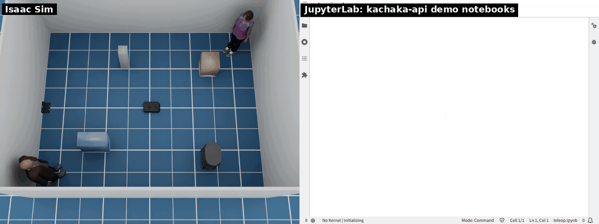

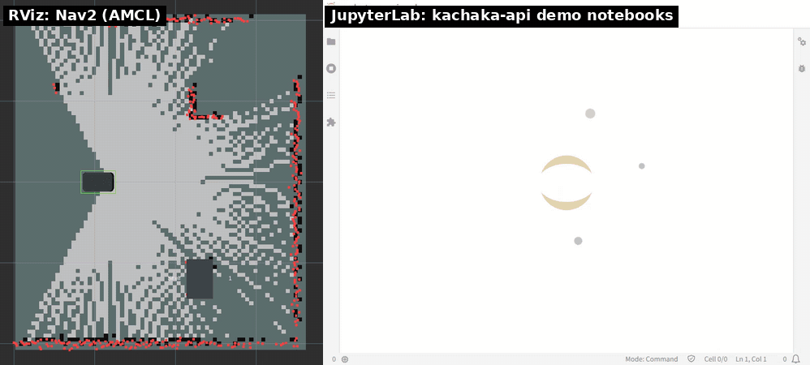


The map that `get_png_map` returns is grayscale, so `plot_map_robot_lidar` draws it in
matplotlib's default colormap (yellow); the real robot's PNG format is not checked here.

## Performance

Physics runs at 120 Hz. Rendering, which the cameras need, runs at
`--render-hz` (default 10 Hz). Measured real-time factor, headless, RTX 2080 Ti,
640×480 cameras:

| `--render-hz` | 10 | 20 | 30 |
|---|---|---|---|
| RTF | 1.45 | 0.96 | 0.71 |

The simulator is paced to real time (`--realtime 1.0`), so RTF above 1 means it
keeps up. Use `--no-cameras` when you do not need images.

### Camera images on the ROS 2 side

Fast DDS's default socket buffers drop large images. Subscribers need bigger
buffers:

```bash
export FASTDDS_BUILTIN_TRANSPORTS=UDPv4?sockets_size=4194304
```

`docker/compose.yaml` sets this already.

## Tests

### Without the simulator

These run in CI (`.github/workflows/ci.yml`) on every push and pull request:

```bash
uvx ruff@0.17.1 check                                   # lint
uv run --no-project --with pytest --with numpy --with pyyaml --with pillow python -m pytest
                                                        # tests/unit: config, drive, power, IMU, URDF, STL, maps
docker run --rm kachaka-isaac-sim-ros:jazzy bash -c \
    'colcon test --packages-select kachaka_sim_bringup && colcon test-result --verbose'
docker run --rm -v $PWD:/repo kachaka-isaac-sim-ros:jazzy python3 /repo/tests/nav2_config_check.py
python3 scripts/build_usd.py --urdf-only                # build/kachaka.urdf, for the next one
docker run --rm -v $PWD:/repo kachaka-isaac-sim-ros:jazzy python3 /repo/tests/api_fake_check.py
docker run --rm -v $PWD:/repo kachaka-isaac-sim-ros:jazzy python3 /repo/tests/speed_limit_check.py
uv run --no-project --with pyyaml python scripts/run_scenarios.py scenarios/fake_room.yaml --backend fake
```

The unit tests on the URDF need `scripts/fetch_assets.py` first.
`tests/nav2_config_check.py` starts slam.launch.py (with Nav2) and then
navigation.launch.py on the saved map, with `fake_robot` (a point robot in an
empty room, `ros2 run kachaka_sim_bringup fake_robot`) in place of the
simulator. It checks that every lifecycle manager comes up and that Nav2
goals succeed.

`tests/speed_limit_check.py` measures the top speeds of manual and autonomous
commands with and without a docked shelf in `scripts/fake_sim.py` (add
`--external` to check a running simulator started with `--shelf 0 0 0 --no-people`).

`tests/api_fake_check.py` runs `tests/api_check.py --no-cameras` (the
kachaka-api regression check: move_to_pose, rotate_in_place, return_home,
shelves, error codes, history and more) against `scripts/fake_sim.py`, with
SLAM, Nav2 and the command server as for the simulator. `fake_sim.py` runs the
simulator's own ROS node and gRPC server, and replaces Isaac Sim with a
kinematic robot in a 2D copy of the default room: the LiDAR sees its walls,
boxes, people and shelf legs, the charger and the shelves work, and the robot
stops at whatever it would run into. Add `-e FAKE_SIM_ARGS=--trace` to log the
robot's pose and command once a second (in `fake_sim.log` under `CHECK_LOG_DIR`). It has no physics and no cameras, so
these still need the simulator: camera images and object detection, the
cliff and collision detection, how the robot moves under physics (wheel slip,
bumping into things, pushing a shelf), Isaac scenes, and switching to a saved
map (`tests/api_map_check.py`, `navigation.launch.py`).

CI has no GPU, so the simulator itself is checked locally:
`scripts/smoke_test.sh --nav` starts it headless and runs
`tests/ros_smoke_check.py`, then with SLAM + Nav2 the navigation, docking,
shelf, command and object detection checks one after another in the same simulator run (each
starts with `sim/reset`). A second run with a wall and a door runs `tests/ros_door_check.py`
(Nav2 through the door, round it while it is closed, and through it again once it opens).
A third run with `layouts/room_auto_door.yaml` runs `tests/ros_auto_door_check.py` (Nav2
through an automatic door that is never commanded: it closes behind the robot and opens as
the robot comes back to it). A fourth run with `layouts/room_movers.yaml` runs `tests/ros_nav_check.py --no-collisions`
(the Nav2 goals among people and a cart on the move, without touching them).
It ends with `tests/ros_hazard_check.py` in a fifth run with a
drop, and logs the collisions seen during the Nav2 checks to `build/smoke_collisions.log`.

### With the simulator

With the simulator running, from the ROS 2 container
(`docker compose -f docker/compose.yaml run --rm -v $PWD/tests:/tests shell`):

```bash
python3 /tests/ros_teleop_check.py   # drive the robot and print odometry
python3 /tests/ros_sensor_check.py   # topic rates, LiDAR ranges against the room walls, IMU
python3 /tests/ros_camera_check.py /tmp/images
python3 /tests/ros_nav_check.py      # Nav2 goals (needs slam.launch.py nav:=true)
python3 /tests/ros_nav_check.py --world office   # route in an Isaac scene (sim started with the same --world)
python3 /tests/ros_dock_check.py     # charger, battery and RETURN_HOME (same)
python3 /tests/ros_shelf_check.py    # shelf docking, towing and placing (same)
python3 /tests/ros_command_check.py  # MOVE_TO_POSE, MOVE_TO_LOCATION, SPEAK, goal_pose, cancel_all (same)
python3 /tests/ros_detection_check.py   # object_detection/result while turning in place (same)
python3 /tests/ros_hazard_check.py   # steps and collisions (no Nav2; sim started with --drop 1.0 0.0 0.4 0.8)
python3 /tests/ros_door_check.py     # Nav2 and a door (sim started with --layout layouts/room_door.yaml)
python3 /tests/ros_auto_door_check.py   # Nav2 and an automatic door (sim started with --layout layouts/room_auto_door.yaml)
python3 /tests/ros_nav_check.py --no-collisions   # Nav2 goals among moving people (sim started with --layout layouts/room_movers.yaml)
```

The kachaka-api check runs on the host with the official client (same setup):

```bash
uv run --no-project --with kachaka-api==3.17.5.0 python tests/api_check.py
uv run --no-project --with kachaka-api==3.17.5.0 python tests/api_aio_check.py  # asyncio client and its streams
```

`tests/api_map_check.py` checks `switch_map` and `set_robot_pose` on a saved
map; its docstring gives the steps (save the SLAM map, then restart the ROS 2
side with `navigation.launch.py`).

`scripts/record_demo.sh` records the GIFs above (`scripts/record_demo.sh dock` for the charger, `shelf` for the shelf, `front_stop` for the front obstacle stop, `notebooks sensors|control|map` for the demo notebooks in JupyterLab, with Chromium on the host); `scripts/record_torch_demo.sh docs/torch.gif` records the torch lights; `scripts/record_dashboard_demo.py docs/dashboard.gif` records the web dashboard (with the simulator, Nav2 and the dashboard running, and Chromium on the host), and with `--scenario reset` it records `docs/sim_reset.gif`. `scripts/detection_demo.py --out docs/object_detection.gif` records object detection (kachaka-api only).

## License

Apache License 2.0. See [LICENSE](LICENSE) and [NOTICE](NOTICE).
This is an unofficial project, not affiliated with Preferred Robotics, Inc.,
the maker of Kachaka.

The robot model comes from [pf-robotics/kachaka-api](https://github.com/pf-robotics/kachaka-api)
(Apache-2.0), the shelf model from [GAI-313/kachaka_shelf_description](https://github.com/GAI-313/kachaka_shelf_description)
(MIT). Both are downloaded by `scripts/fetch_assets.py` and not redistributed here.
