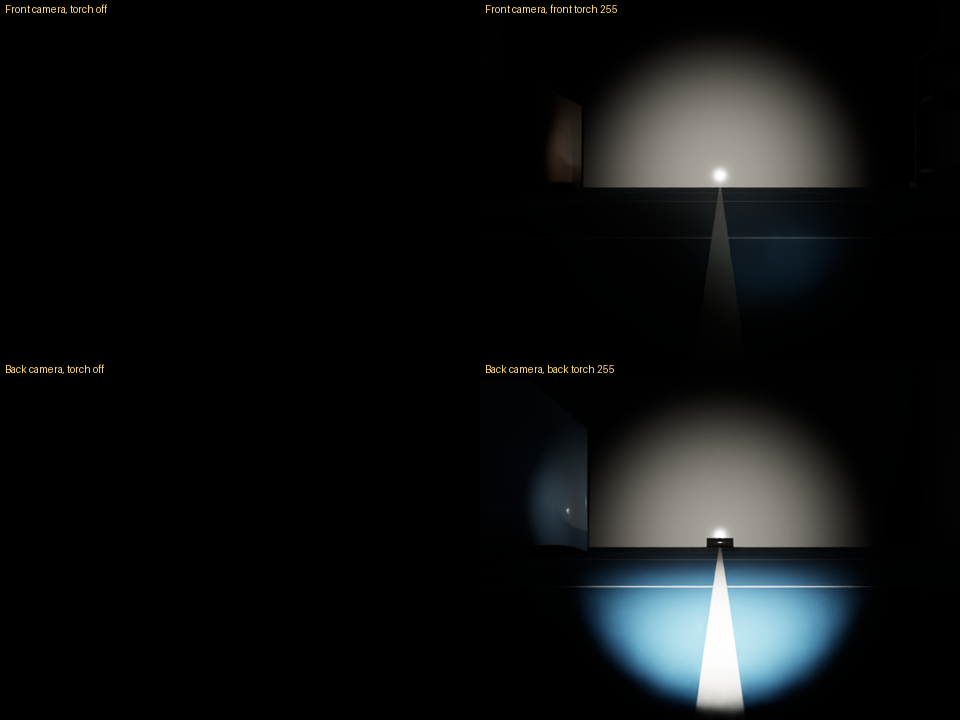

# kachaka_isaac_sim

[日本語](README.ja.md)

A simulator for the [Kachaka](https://kachaka.life/) home robot on
NVIDIA Isaac Sim 6.1, with the same ROS 2 interface as the official
[kachaka-api](https://github.com/pf-robotics/kachaka-api) bridge. Code written
for a real Kachaka (topics under `/kachaka`) runs against the simulator unchanged.


*Left: Isaac Sim. Right: RViz with slam_toolbox and Nav2 (2× speed).*

## Features

- Robot model converted from the official URDF and meshes.
- Differential drive with the real speed limits (0.3 m/s, 1.57 rad/s), torque-limited wheels and casters.
- Sensors: 2D LiDAR, front/back RGB cameras, ToF depth camera, IMU.
- Odometry (fused and wheel), TF, `joint_states`, `robot_description`, version stub.
- Charging dock and battery: the battery drains while driving and charges on the dock.
- Front obstacle stop, as on the real robot: forward motion brakes in front of an obstacle,
  from any source (teleop, Nav2, kachaka-api). It can be switched off, like in the smartphone app.
- Front and back torch lights, set through kachaka-api like on the real robot.
- Same topic names, message types and QoS as the real bridge.
- Worlds: a walled room with a Kachaka Shelf, or Isaac Sim scenes (office, hospital, warehouse).
- Docker image with slam_toolbox, Nav2, RViz and teleop, set up for Kachaka.
  Nav2 never drives backwards, since Kachaka has no rear range sensor.
- `kachaka_command/execute` with every command type of the real bridge: MOVE_TO_POSE,
  MOVE_TO_LOCATION, RETURN_HOME, SPEAK (text only), the Kachaka Shelf commands
  (DOCK_SHELF, UNDOCK_SHELF, MOVE_SHELF, RETURN_SHELF) and the motion commands
  (MOVE_FORWARD, ROTATE_IN_PLACE, …), built on Nav2. Also `goal_pose` and auto homing.
- The [kachaka-api](https://github.com/pf-robotics/kachaka-api) gRPC API on port 26400,
  with every RPC, so the official Python client (`KachakaApiClient`) works without a robot.

### Commands

```bash
ros2 action send_goal /kachaka/kachaka_command/execute kachaka_interfaces/action/ExecKachakaCommand \
    "{kachaka_command: {command_type: 13, move_to_pose_command_x: 1.0, move_to_pose_command_y: 0.5,
      move_to_pose_command_yaw: 1.57}, cancel_all: true}"   # MOVE_TO_POSE_COMMAND
ros2 topic pub --once /kachaka/goal_pose geometry_msgs/PoseStamped \
    "{header: {frame_id: map}, pose: {position: {x: 1.0, y: 0.5}, orientation: {w: 1.0}}}"
```

| Command | What it does |
|---|---|
| MOVE_TO_POSE | Nav2 goal in the map frame |
| MOVE_TO_LOCATION | Nav2 goal to a location from `layout/locations/list`; the charger (`home`) runs RETURN_HOME |
| SPEAK | no audio: the text goes to the log and to `sim/speech` |
| MOVE_FORWARD, ROTATE_IN_PLACE | drives the distance or turns the angle on odometry; MOVE_FORWARD stops (−9) at an obstacle ahead |
| MOVE_BY_VELOCITY_WITH_MUTED_SENSORS | drives at the velocity for the duration, with the front obstacle stop muted |
| LOCK | holds the robot still for the duration |
| DOCK_ANY_SHELF_WITH_REGISTRATION | docks the shelf nearest to the location (within 0.5 m) |
| LOCALIZE | succeeds at once: the simulator never loses its pose |
| DEPART_FROM_CHARGER | drives 0.3 m off the charger; fails (−13) when not on it |

As on the real robot, `cancel_all: true` stops the running command; without
it a command waits until the earlier ones finish. `tts_on_success` is sent to
`sim/speech` after a successful command. `goal_pose` sends MOVE_TO_POSE
without `cancel_all`, like the real bridge.

### Front obstacle stop


The real Kachaka stops by itself when something is just in front of it; its
smartphone app turns this off. The simulator does the same for every velocity
command, whatever sends it (teleop, Nav2, `set_robot_velocity`, commands):

- Forward motion brakes when the LiDAR clearance ahead of the body, in a lane
  0.30 m wide, falls to `margin + v * scan period + v² / (2 * deceleration)`.
  At rest the robot keeps 3 cm (`front_stop.margin`). Turning and backing up
  stay allowed, and the robot drives on once the way is clear.
- The lane is narrower than a shelf's legs, so the robot still drives under a
  Kachaka Shelf; a towed shelf is not seen.
- MOVE_BY_VELOCITY_WITH_MUTED_SENSORS and MOVE_FORWARD with `mute_sensors`
  turn it off while they run. MOVE_FORWARD fails with −9 when the stop holds
  the robot for 1 s.
- `config/robot.yaml` (`front_stop`) sets the initial state and the zone. The
  app setting is not part of kachaka-api, so the simulator-only service
  `sim/front_stop/set_enabled` switches it at run time:

```bash
ros2 service call /kachaka/sim/front_stop/set_enabled std_srvs/srv/SetBool "{data: false}"
ros2 topic echo /kachaka/sim/front_stop/state   # {"enabled": false, "muted": false, "blocked": false}
```

The real stop distance and zone are not published; the values are estimates.
The LiDAR scans at 10.5 cm, so lower obstacles are not seen.

### Torch lights



The real Kachaka has a torch next to its front and its back camera. In the
simulator each is a spotlight at the camera, aimed along it, and
`SetFrontTorchIntensity` / `SetBackTorchIntensity` (0-255, 0 is off) set it.
The Python client has no wrapper for them, so call the gRPC stub:

```python
from kachaka_api import KachakaApiClient
from kachaka_api.generated import kachaka_api_pb2 as pb2

client = KachakaApiClient("127.0.0.1:26400")
client.stub.SetFrontTorchIntensity(pb2.SetFrontTorchIntensityRequest(intensity=255))
```

- The real robot has no RPC to read the levels back; the simulator publishes
  them on `sim/torch` (latched JSON `{"front", "back"}`).
- The default scenes are bright, so the torches barely show. `--dome-light 0`
  turns the ambient light off in the default room (Isaac Sim scenes bring
  their own lights).
- Brightness, beam and colour are guesses (`torch` in `config/robot.yaml`).

### Returning to the charger


*RETURN_HOME (2× speed). Nav2 drives to a point in front of the charger, then the robot backs onto it, as the real one does.*

```bash
ros2 action send_goal /kachaka/kachaka_command/execute kachaka_interfaces/action/ExecKachakaCommand \
    "{kachaka_command: {command_type: 8}}"   # RETURN_HOME_COMMAND
```

This needs the ROS 2 stack with Nav2 (`NAV=true ... up slam`, or `up navigation`),
which runs `command_server`. The robot leaves the charger with any Nav2 goal.
Battery rates and the charger's size are estimates (`config/robot.yaml`).

### Carrying a shelf


*DOCK_SHELF, then MOVE_SHELF to another location and UNDOCK_SHELF (3× speed).*

The room has one Kachaka Shelf (`S01`, home location `S01_home`) and one other
location (`L01`). The robot drives in under a shelf forward, raises its pin and
tows the shelf on its casters (≤ 0.5 m/s, `drive.max_linear_vel_towing`; Nav2's
own limit of 0.3 m/s is lower). Nav2's footprint grows to the shelf's while towing.
Undocking lowers the pin and drives forward out of the shelf; it fails if
something blocks the way.

```bash
ros2 action send_goal /kachaka/kachaka_command/execute kachaka_interfaces/action/ExecKachakaCommand \
    "{kachaka_command: {command_type: 1, move_shelf_command_target_shelf_id: S01,
      move_shelf_command_destination_location_id: L01, move_shelf_command_undock_on_destination: true}}"   # MOVE_SHELF_COMMAND
```

| Command | What it does |
|---|---|
| DOCK_SHELF | docks with the shelf in front of the robot (within 1.5 m) |
| UNDOCK_SHELF | puts the towed shelf down and drives out forward |
| MOVE_SHELF | docks with the shelf if needed, tows it to a location, optionally undocks |
| RETURN_SHELF | MOVE_SHELF to the shelf's home location, then undocks |
| RETURN_HOME | returns a towed shelf home first, then docks with the charger |

Shelves are listed on `layout/shelves/list` and their homes on
`layout/locations/list`. Place shelves with `--shelf X Y YAW`. The shelf lands
where SLAM puts the location, a few centimetres off the world.
`robot_description` is the robot alone, as on the real Kachaka; RViz draws the
shelves from `/shelf_markers` (MarkerArray, published by `shelf_markers`).

## Requirements

- Ubuntu 24.04, x86_64
- NVIDIA RTX GPU and driver supported by Isaac Sim 6.1 (tested on an RTX 2080 Ti, driver 595)
- [uv](https://docs.astral.sh/uv/), Docker with Compose, git, and about 40 GB of disk

## Quick start

```bash
# 1. Install Isaac Sim 6.1 into .venv (large download)
uv sync

# 2. Fetch the official Kachaka description and build the robot USD
uv run python scripts/fetch_assets.py
uv run python scripts/build_usd.py

# 3. Start the simulator (GUI; add --headless for no window)
scripts/run_sim.sh
```

`scripts/run_sim.sh` sets `OMNI_KIT_ACCEPT_EULA=YES`. By running it you accept
the [NVIDIA Isaac Sim license](https://docs.isaacsim.omniverse.nvidia.com/latest/common/NVIDIA_Omniverse_License_Agreement.html).
The first start compiles shaders and takes a few minutes.

In another terminal, run the ROS 2 tools in Docker:

```bash
docker compose -f docker/compose.yaml build
xhost +local:            # allow RViz windows from containers

# Drive with the keyboard
docker compose -f docker/compose.yaml run --rm teleop

# Build a map with slam_toolbox (add NAV=true to also send Nav2 goals from RViz)
NAV=true docker compose -f docker/compose.yaml up slam

# Save the map, then navigate on it
docker compose -f docker/compose.yaml run --rm shell \
    ros2 run nav2_map_server map_saver_cli -f /maps/map
docker compose -f docker/compose.yaml up navigation
```

The containers use host networking, so they find the simulator on the same
machine through DDS discovery.

## Simulator options

```bash
scripts/run_sim.sh --world office        # Isaac Sim scenes: office, hospital, warehouse, simple_room
scripts/run_sim.sh --world /path/to.usd  # any USD scene
scripts/run_sim.sh --x 1.0 --y 0.5 --yaw 1.57
scripts/run_sim.sh --no-cameras          # faster, when you only need LiDAR and odometry
scripts/run_sim.sh --dome-light 0        # dark scene (ambient light, default 800), e.g. to see the torches
scripts/run_sim.sh --render-hz 20        # render/camera loop rate (see Performance)
scripts/run_sim.sh --charger X Y YAW     # place the charger (default: by the west wall of the room)
scripts/run_sim.sh --no-charger
scripts/run_sim.sh --shelf X Y YAW       # place a shelf (repeatable; default: one in the room)
scripts/run_sim.sh --no-shelves
scripts/run_sim.sh --api-port 26400      # kachaka-api gRPC port (default 26400; 0 turns it off)
scripts/run_sim.sh --help
```

Robot parameters (speed limits, sensor resolution and rates, noise) are in
[`config/robot.yaml`](config/robot.yaml). Values not published by Preferred
Robotics are marked *(est.)*.

### Isaac Sim scenes

Isaac Sim scenes are streamed from NVIDIA's asset server and cached locally
after the first load. Each has a default spawn pose in free floor space;
`--x`, `--y` and `--yaw` default to it (to 0 in `room`, `empty` and USD paths).
The SLAM map frame starts at the spawn pose.

| `--world` | Spawn (x, y, yaw) | First load | Start, cached | RTF, cameras / `--no-cameras` |
|---|---|---|---|---|
| `office` | 0, 0, 1.5708 (lobby, facing north) | minutes | 22 s | 1.2 / 1.9 |
| `hospital` | 0, 0, 0 (lobby south of the wards) | 7 min | 21 s | 1.3 / 2.0 |
| `warehouse` | −13, 11, 1.5708 (in an aisle between racks) | — | 40 s | 1.2 / 1.9 |
| `simple_room` | −2.5, 0, 0 (beside the table) | seconds | 15 s | 1.4 / 2.0 |

First load fetches the scene from the Isaac Sim asset server. Start is from
launch to `[kachaka] running` once the assets are cached. RTF is simulated
time over wall time with `--realtime 0` and the robot standing still, on an
RTX 2080 Ti; the default `--realtime 1` caps it at 1.

`tests/ros_nav_check.py --world <name>` drives a route in each of them with
SLAM and Nav2. Things to know about the scenes:

- **Low and thin furniture.** The LiDAR scans one plane 10.5 cm above the
  floor, and Nav2 only knows what it sees there. The 5 cm foot slabs of the
  simple_room table, chair legs in the hospital and desk legs in the office
  appear as small dots or not at all. Plan routes around such furniture.
- **Spaces longer than the LiDAR range.** Rays with no return within 10 m
  leave the middle of long corridors and halls unknown on the map, and NavFn
  fails to plan across about 8 m of unknown space. Send far goals through
  waypoints, as the test routes do.
- **Door sills.** The office doorways at y = 12 and y = 24 have 4–5 mm
  sills. The robot crosses steps up to about 6 mm: its body is rigid, and the
  rear caster's 6 mm gap above the floor sets how far it can tilt while the
  front climbs (the body box clears the floor by 8 mm). Preferred Robotics
  publishes no step limit and recommends barrier-free floors.
- **Glass doors** in the office stand open; their frames are solid.
- **Warehouse racks** show only their legs at the LiDAR height, so the
  costmap sees a row of posts rather than a wall, and Nav2 may route between
  them under the shelves. The test stays in one aisle (x = −13). The hall
  north of the racks (y > 25) is beyond the LiDAR range from the aisle and
  stays off the map until the robot gets closer.

## ROS 2 interface

Namespace `/kachaka`, as on the real robot.

| Topic | Type | Rate |
|---|---|---|
| `manual_control/cmd_vel` | `geometry_msgs/Twist` (subscribed) | |
| `goal_pose` | `geometry_msgs/PoseStamped` (subscribed): MOVE_TO_POSE | |
| `odometry/odometry` | `nav_msgs/Odometry` | 20 Hz |
| `wheel_odometry/wheel_odometry` | `nav_msgs/Odometry` | 20 Hz |
| `lidar/scan` | `sensor_msgs/LaserScan` | 10 Hz |
| `imu/imu` | `sensor_msgs/Imu` | 100 Hz |
| `front_camera/image_raw`, `back_camera/image_raw` | `sensor_msgs/Image` (rgb8, 640×480) + `camera_info` | 10 Hz |
| `tof_camera/image_raw` | `sensor_msgs/Image` (16UC1, mm) + `camera_info` | 10 Hz |
| `joint_states`, `robot_description` | | |
| `robot_info/battery_state` | `sensor_msgs/BatteryState` (charging or discharging) | 1 Hz |
| `robot_info/version` | stub | |
| `sim/ground_truth` | `nav_msgs/Odometry` (simulator only) | 20 Hz |
| `sim/charger_pose` | `geometry_msgs/PoseStamped` (simulator only, latched) | |
| `sim/charger_detection` | `geometry_msgs/PoseStamped`, charger relative to the robot within 1.5 m (simulator only) | 20 Hz |
| `sim/layout` | `std_msgs/String`, JSON with the shelves and extra locations (simulator only, latched) | |
| `sim/shelf_poses` | `geometry_msgs/PoseArray`, shelves in the map frame (simulator only) | 2 Hz |
| `sim/shelf_detection` | `geometry_msgs/PoseArray`, shelves relative to the robot (simulator only) | 20 Hz |
| `sim/shelf_docked` | `std_msgs/String`, id of the towed shelf or empty (simulator only, latched) | |
| `sim/shelf_dock` | `std_srvs/SetBool` service: raise or lower the pin (simulator only) | |
| `sim/speech` | `std_msgs/String`, text of SPEAK and `tts_on_success` (simulator only) | |
| `sim/front_stop/state` | `std_msgs/String`, JSON `{"enabled", "muted", "blocked"}` of the front obstacle stop (simulator only, latched, on change) | |
| `sim/front_stop/set_enabled`, `sim/front_stop/mute` | `std_srvs/SetBool` services: switch the front obstacle stop (the app setting), or mute it while a command runs (`command_server`) (simulator only) | |
| `sim/torch` | `std_msgs/String`, JSON `{"front", "back"}`: torch levels 0-255 (simulator only, latched) | |
| `sim/command/start`, `sim/command/cancel` | `std_msgs/String`, JSON: commands from the kachaka-api server to `command_server` (simulator only) | |
| `sim/command/state` | `std_msgs/String`, JSON: running command and last result (simulator only, latched) | |

`kachaka_sim_bringup`'s `command_server` provides what the real robot does
itself: the `kachaka_command/execute` action, `goal_pose`,
`layout/locations/list` and `layout/shelves/list`, and the
`auto_homing/set_enabled` service. Do not run it with a real Kachaka
(`command_server:=false`).

`/clock` and `/tf` are published at the top level; use `use_sim_time:=true` on
the ROS 2 side. See [docs/design.md](docs/design.md) for the details and the
decisions behind them.

### Using the ROS 2 package with a real Kachaka

`ros2_ws/src/kachaka_sim_bringup` only depends on the `/kachaka` topics, so it
should also work with a real robot (`use_sim_time:=false`, `command_server:=false`). This has not been
tested.

## kachaka-api (gRPC)

The simulator serves the [kachaka-api](https://github.com/pf-robotics/kachaka-api)
gRPC API on port 26400, like the real robot. Install the official client on
the host (no ROS needed) and connect to the simulator:

```bash
pip install kachaka-api
```

```python
from kachaka_api import KachakaApiClient

client = KachakaApiClient("127.0.0.1:26400")
print(client.get_robot_pose())
client.update_resolver()
client.speak("hello")
client.move_to_location("L01")
client.move_shelf("S01", "L01")
client.return_shelf("S01")
client.return_home()
```

Commands and the locations need the ROS 2 side (`slam.launch.py nav:=true`
or `navigation.launch.py`), since `command_server` runs them. The robot pose
is in the map frame of slam_toolbox or AMCL.

Every RPC of the `KachakaApi` service (kachaka-api 3.17.5.0) is implemented.
The client methods are the RPC names in snake_case
(`GetRobotPose` → `get_robot_pose`). Where the simulator differs from the robot:

| Area | RPCs | In the simulator |
|---|---|---|
| Robot info | `GetRobotSerialNumber`, `GetRobotVersion`, `IsReady`, `GetError`, `GetRobotErrorCodeJson`, `GetRobotPose`, `GetBatteryInfo` | |
| Sensors | `GetRosImu`, `GetRosOdometry`, `GetRosWheelOdometry`, `GetRosLaserScan`, `Get{Front,Back,Tof}CameraRos{CameraInfo,Image,CompressedImage}`, `GetStaticTransform`, `GetDynamicTransform` | |
| Map | `GetPngMap`, `GetMapList`, `GetCurrentMapId`, `LoadMapPreview`, `ExportMap`, `ImportMap`, `ImportImageAsMap` | see [Maps](#maps) |
| Map (saved map) | `SwitchMap`, `SetRobotPose` | need `navigation.launch.py` (map_server and AMCL); fail with −16 under SLAM. `inherit_docking_state_and_docked_shelf` is Kachaka Pro only (−17) |
| Commands | `StartCommand`, `CancelCommand`, `GetCommandState`, `GetLastCommandResult`, `Proceed`, `GetHistoryList` | history keeps the last 100 commands, until the simulator stops |
| Shortcuts | `GetShortcuts`, `StartShortcutCommand` | defined in `config/robot.yaml` (`api.shortcuts`) |
| Layout | `GetLocations`, `GetLocationsDigest`, `GetShelves`, `GetShelvesDigest`, `GetMovingShelfId`, `ResetShelfPose` | `ResetShelfPose` puts the shelf back at its home; fails while the robot tows it |
| Control | `SetManualControlEnabled`, `GetManualControlEnabled`, `SetRobotVelocity`, `SetAutoHomingEnabled`, `GetAutoHomingEnabled`, `SetSpeakerVolume`, `GetSpeakerVolume` | |
| Safety | `SetEmergencyStop`, `RestartRobot` | the emergency stop halts the wheels, cancels all commands and refuses new ones (−14) until `RestartRobot`, which clears it; the simulator itself does not restart |
| Sound | `GetSoundList`, `PlaySound`, `StopSound`, `AddSound`, `DeleteSound` | no audio: the sound name goes to `sim/sound`; added sounds live until the simulator stops |
| Torches | `SetFrontTorchIntensity`, `SetBackTorchIntensity` | a spotlight at each camera, see [Torch lights](#torch-lights); levels are clamped to 0-255 and published on `sim/torch` |
| No-ops | `ActivateLaserScan`, `GetObjectDetection`, `GetObjectDetectionFeatures` | object detection is always empty |

All `StartCommand` commands of kachaka-api 3.17.5.0 are implemented (see
[Commands](#commands)). DEPART_FROM_CHARGER is newer than that release, so
it can be sent only through the ROS 2 action (`command_type: 23`) until a
kachaka-api release includes it.

Simulator error codes, shown by `get_robot_error_code` like the robot's own:

| Code | Meaning |
|---|---|
| −1 … −11 | command errors from `command_server` (unsupported, no charger, docking failed, canceled, navigation failed, blocked, …) |
| −12 | manual control is disabled |
| −13 | not on the charger |
| −14 | emergency stop |
| −15 | map error (unknown id, bad file) |
| −16 | needs a saved map (`navigation.launch.py`) |
| −17 | Kachaka Pro only |

### Maps

Maps are Nav2 map pairs in `maps/` (mounted at `/maps` in the containers):
`<id>.yaml` plus its `<id>.pgm`, as `map_saver_cli` writes them. The id is
the file name. The yaml may also hold `name` (shown by `get_map_list`) and
`charger_pose: [x, y, yaw]` (the default pose after `switch_map`).

- Under SLAM the current map is `sim`, slam_toolbox's live `/map`. Export it to
  keep it: `export_map("sim", "slam.zip")` then `import_map("slam.zip")`
  writes `maps/slam.yaml`. The id `sim` is never given to a saved map.
- Under `navigation.launch.py` the current map is the one it was started with;
  `get_map_list` lists the files in `maps/` and `switch_map` loads another one
  into map_server and sets the initial pose.
- `export_map` writes a zip of the two files, which `import_map` reads back.
  `import_image_as_map` takes a PNG (Kachaka's palette, or any image: dark is
  occupied, light free, mid gray unknown) with the origin at its bottom-left
  corner.

## Performance

Physics runs at 120 Hz. Rendering, which the cameras need, runs at
`--render-hz` (default 10 Hz). Measured real-time factor, headless, RTX 2080 Ti,
640×480 cameras:

| `--render-hz` | 10 | 20 | 30 |
|---|---|---|---|
| RTF | 1.45 | 0.96 | 0.71 |

The simulator is paced to real time (`--realtime 1.0`), so RTF above 1 means it
keeps up. Use `--no-cameras` when you do not need images.

### Camera images on the ROS 2 side

Fast DDS's default socket buffers drop large images. Subscribers need bigger
buffers:

```bash
export FASTDDS_BUILTIN_TRANSPORTS=UDPv4?sockets_size=4194304
```

`docker/compose.yaml` sets this already.

## Tests

### Without the simulator

These run in CI (`.github/workflows/ci.yml`) on every push and pull request:

```bash
uvx ruff@0.17.1 check                                   # lint
uv run --no-project --with pytest --with numpy --with pyyaml --with pillow python -m pytest
                                                        # tests/unit: config, drive, power, IMU, URDF, STL, maps
docker run --rm kachaka-isaac-sim-ros:jazzy bash -c \
    'colcon test --packages-select kachaka_sim_bringup && colcon test-result --verbose'
docker run --rm -v $PWD:/repo kachaka-isaac-sim-ros:jazzy python3 /repo/tests/nav2_config_check.py
```

The unit tests on the URDF need `scripts/fetch_assets.py` first.
`tests/nav2_config_check.py` starts slam.launch.py (with Nav2) and then
navigation.launch.py on the saved map, with `fake_robot` (a point robot in an
empty room, `ros2 run kachaka_sim_bringup fake_robot`) in place of the
simulator. It checks that every lifecycle manager comes up and that Nav2
goals succeed.

CI has no GPU, so the simulator itself is checked locally:
`scripts/smoke_test.sh --nav` starts it headless and runs
`tests/ros_smoke_check.py` and `tests/ros_nav_check.py`.

### With the simulator

With the simulator running, from the ROS 2 container
(`docker compose -f docker/compose.yaml run --rm -v $PWD/tests:/tests shell`):

```bash
python3 /tests/ros_teleop_check.py   # drive the robot and print odometry
python3 /tests/ros_sensor_check.py   # topic rates, LiDAR ranges against the room walls, IMU
python3 /tests/ros_camera_check.py /tmp/images
python3 /tests/ros_nav_check.py      # Nav2 goals (needs slam.launch.py nav:=true)
python3 /tests/ros_nav_check.py --world office   # route in an Isaac scene (sim started with the same --world)
python3 /tests/ros_dock_check.py     # charger, battery and RETURN_HOME (same)
python3 /tests/ros_shelf_check.py    # shelf docking, towing and placing (same)
python3 /tests/ros_command_check.py  # MOVE_TO_POSE, MOVE_TO_LOCATION, SPEAK, goal_pose, cancel_all (same)
```

The kachaka-api check runs on the host with the official client (same setup):

```bash
uv run --no-project --with kachaka-api==3.17.5.0 python tests/api_check.py
```

`tests/api_map_check.py` checks `switch_map` and `set_robot_pose` on a saved
map; its docstring gives the steps (save the SLAM map, then restart the ROS 2
side with `navigation.launch.py`).

`scripts/record_demo.sh` records the GIFs above (`scripts/record_demo.sh dock` for the charger, `shelf` for the shelf, `front_stop` for the front obstacle stop).

## License

Apache License 2.0. See [LICENSE](LICENSE) and [NOTICE](NOTICE).
This is an unofficial project, not affiliated with Preferred Robotics, Inc.,
the maker of Kachaka.

The robot model comes from [pf-robotics/kachaka-api](https://github.com/pf-robotics/kachaka-api)
(Apache-2.0), the shelf model from [GAI-313/kachaka_shelf_description](https://github.com/GAI-313/kachaka_shelf_description)
(MIT). Both are downloaded by `scripts/fetch_assets.py` and not redistributed here.
