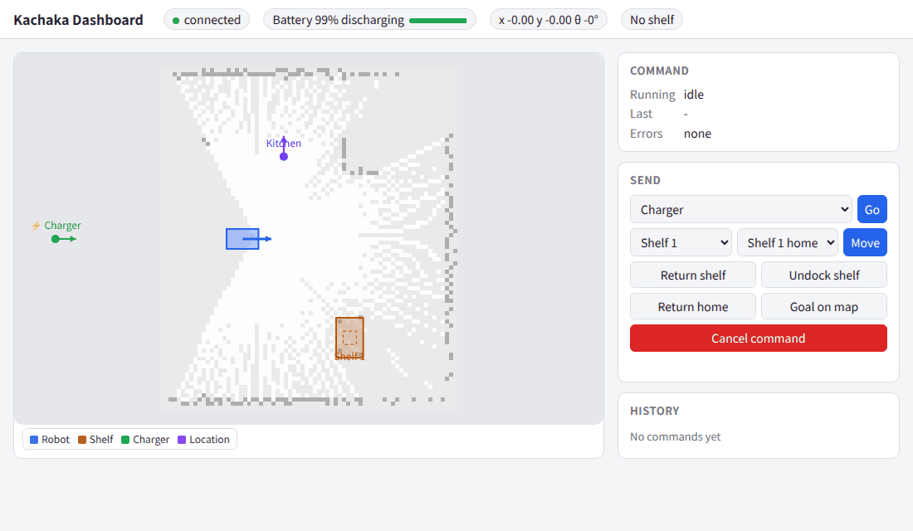
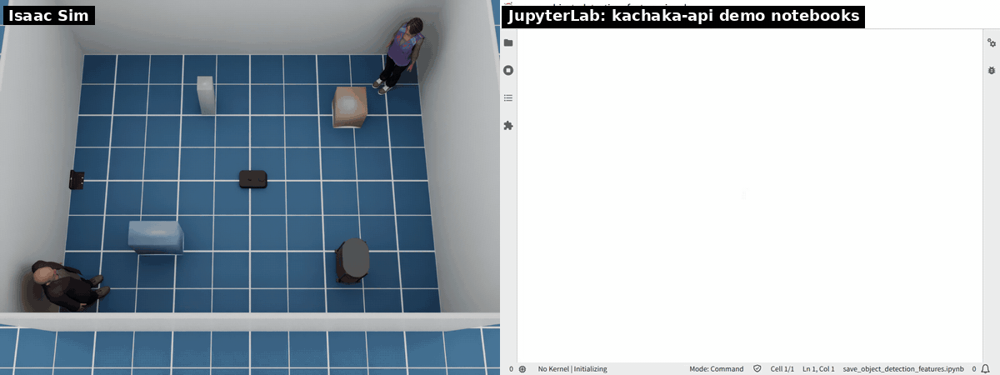

# kachaka-api（gRPC）

[English](../kachaka_api.md) · [README](../../README.ja.md)

シミュレータは実機と同じくポート 26400 で [kachaka-api](https://github.com/pf-robotics/kachaka-api)
の gRPC API を提供します。ホストに公式クライアントを入れて（ROS は不要）シミュレータに接続します。

```bash
pip install kachaka-api
```

```python
from kachaka_api import KachakaApiClient

client = KachakaApiClient("127.0.0.1:26400")
print(client.get_robot_pose())
client.update_resolver()
client.speak("hello")
client.move_to_location("L01")
client.move_shelf("S01", "L01")
client.return_shelf("S01")
client.return_home()
```

コマンドと場所の一覧は `command_server` が扱うので、ROS 2 側（`slam.launch.py nav:=true` または
`navigation.launch.py`）が必要です。ロボットの位置は slam_toolbox または AMCL の map 座標です。

`KachakaApi` サービス（kachaka-api 3.17.5.0）の RPC はすべて実装しています。
クライアントのメソッド名は RPC 名を snake_case にしたものです（`GetRobotPose` → `get_robot_pose`）。
実機との違いは次のとおりです。

| 分類 | RPC | シミュレータでの動作 |
|---|---|---|
| ロボット情報 | `GetRobotSerialNumber`、`GetRobotVersion`、`IsReady`、`GetError`、`GetRobotErrorCodeJson`、`GetRobotPose`、`GetBatteryInfo` | `GetError` は −14（非常停止）、21051 + 21052（段差で一時停止）、−18（`collision.stop` 時の衝突）を返す。[段差と衝突](robot.md#段差と衝突)を参照 |
| センサー | `GetRosImu`、`GetRosOdometry`、`GetRosWheelOdometry`、`GetRosLaserScan`、`Get{Front,Back,Tof}CameraRos{CameraInfo,Image,CompressedImage}`、`GetStaticTransform`、`GetDynamicTransform` | |
| 地図 | `GetPngMap`、`GetMapList`、`GetCurrentMapId`、`LoadMapPreview`、`ExportMap`、`ImportMap`、`ImportImageAsMap` | [地図](#地図)を参照 |
| 地図（保存済み地図） | `SwitchMap`、`SetRobotPose` | `navigation.launch.py`（map_server と AMCL）が必要。SLAM 中は −16 で失敗。`inherit_docking_state_and_docked_shelf` はカチャカ Pro 専用（−17） |
| コマンド | `StartCommand`、`CancelCommand`、`GetCommandState`、`GetLastCommandResult`、`Proceed`、`GetHistoryList` | 履歴は直近 100 件。シミュレータを止めると消える |
| ショートカット | `GetShortcuts`、`StartShortcutCommand` | `config/robot.yaml`（`api.shortcuts`）で定義 |
| レイアウト | `GetLocations`、`GetLocationsDigest`、`GetShelves`、`GetShelvesDigest`、`GetMovingShelfId`、`ResetShelfPose` | `ResetShelfPose` はシェルフをホームに戻す。ロボットが運搬中なら失敗 |
| 操作 | `SetManualControlEnabled`、`GetManualControlEnabled`、`SetRobotVelocity`、`SetAutoHomingEnabled`、`GetAutoHomingEnabled`、`SetSpeakerVolume`、`GetSpeakerVolume` | |
| 安全 | `SetEmergencyStop`、`RestartRobot` | 非常停止で車輪を止め、全コマンドをキャンセルし、`RestartRobot` で解除するまで新しいコマンドを拒否（−14）。`RestartRobot` は段差や衝突による一時停止からも復帰する。シミュレータ自体は再起動しない |
| サウンド | `GetSoundList`、`PlaySound`、`StopSound`、`AddSound`、`DeleteSound` | 音声なし。サウンド名を `sim/sound` に出す。追加したサウンドはシミュレータを止めると消える |
| トーチ | `SetFrontTorchIntensity`、`SetBackTorchIntensity` | 各カメラの位置のスポットライト（[トーチライト](robot.md#トーチライト)を参照）。値は 0〜255 に丸め、`sim/torch` に出します |
| 物体検出 | `GetObjectDetection`、`GetObjectDetectionFeatures` | シーンの人・シェルフ・充電器。特徴量は実機の検出器ではなく ImageNet の MobileNetV3 から（[物体検出](robot.md#物体検出)を参照） |
| 何もしない | `ActivateLaserScan` | |

kachaka-api 3.17.5.0 の `StartCommand` のコマンドはすべて実装しています（[コマンド](robot.md#コマンド)を参照）。
DEPART_FROM_CHARGER はこのリリースより新しいので、kachaka-api のリリースに入るまでは
ROS 2 のアクション（`command_type: 23`）からのみ送れます。

シミュレータのエラーコード（実機のものと同じく `get_robot_error_code` で説明が取れます）:

| コード | 意味 |
|---|---|
| −1 … −11 | `command_server` のコマンドエラー（未対応、充電器なし、ドッキング失敗、キャンセル、ナビゲーション失敗、障害物など） |
| −12 | 手動操作が無効 |
| −13 | 充電器の上にいない |
| −14 | 非常停止中 |
| −15 | 地図のエラー（存在しない ID、壊れたファイル） |
| −16 | 保存済み地図が必要（`navigation.launch.py`） |
| −17 | カチャカ Pro 専用 |

## asyncio 版クライアント

asyncio 版のクライアント（`kachaka_api.aio.KachakaApiClient`）も使えます。クライアントはイベントループの中で作ってください。
コマンドは `wait_for_completion=False` を付けない限り完了まで待ちます。コマンドの実行中もストリームは値を返し続けます。

```python
import asyncio
from kachaka_api.aio import KachakaApiClient

async def main():
    client = KachakaApiClient("127.0.0.1:26400")
    await client.update_resolver()

    async def watch():
        async for pose in client.robot_pose.stream():
            print(pose.x, pose.y, pose.theta)

    watcher = asyncio.create_task(watch())
    print(await client.move_to_location("L01"))
    watcher.cancel()

asyncio.run(main())
```

`scripts/aio_demo.py` は、これにコマンドの状態の表示も加えた例です。

タイムスタンプ（`stamp_nsec`）は実機と同じく壁時計の時刻です（デモノートブックは `time.time()` と
比べます）。ROS トピックはシミュレーション時間（`/clock`）のままです。サーバは各スタンプを、
それ以前で最新の `/clock` の時点での壁時計とシミュレーション時間の差で変換します
（`kachaka_isaac_sim/wall_clock.py`）。同じシミュレーション時刻はどのストリームでも同じ壁時計の時刻になり、
順序も保たれます。シミュレーションが実時間より遅いときは、スタンプは壁時計より遅れ、`/clock` ごとに追いつきます。

クライアントのストリームはすべてシミュレータで動きます: `robot_pose`, `ros_odometry`, `ros_wheel_odometry`, `ros_imu`, `ros_laser_scan`, `front_camera_ros_image`, `front_camera_ros_compressed_image`, `object_detection`, `object_detection_features`, `png_map`, `command_state`, `last_command_result`, `shelves`, `moving_shelf_id`, `locations`, `map_list`, `current_map_id`, `history_list`, `auto_homing_enabled`, `manual_control_enabled`, `error`。
サーバのカーソル方式のロングポーリングに従います。

- センサーと位置のストリームは配信レートで値を返します
- `png_map` は slam_toolbox が地図を配信するたびに値を返します
- そのほかは、まず現在の値を返し、その後は値が変わったときだけ返します。
  `shelves` と `locations` が変わるのはレイアウトが変わったときだけで、シェルフを牽引しても変わりません。
  牽引中のシェルフは `moving_shelf_id` か `get_shelves()` で取得してください

`set_*_callback` の形でも使えます。kachaka-api 3.17.5.0 では `set_*_callback(None)` でコールバックは止まりますが、
その後クライアントライブラリが `TypeError: 'NoneType' object is not callable`
（"Task exception was never retrieved"）を 1 回出力します。動作に影響はありません。
また、止めた直後に別のコールバックを登録すると古いループも動き続け、コールバックが 1 つの値につき 2 回呼ばれます。
登録し直すのは次の値が届いてからにしてください。どちらもクライアント側のバグです（kachaka-api 3.18.1 でも同じ）。

## 地図

地図は `maps/`（コンテナでは `/maps`）に置く Nav2 形式の 2 ファイル、`<id>.yaml` と `<id>.pgm` です
（`map_saver_cli` が書く形式）。ファイル名が ID になります。yaml には `name`（`get_map_list` で表示）と
`charger_pose: [x, y, yaw]`（`switch_map` 後の既定の位置）も書けます。

- SLAM 中の現在の地図は `sim`（slam_toolbox のその場の `/map`）です。残すにはエクスポートします:
  `export_map("sim", "slam.zip")` のあと `import_map("slam.zip")` で `maps/slam.yaml` ができます。
  `sim` という ID は保存する地図には付きません。
- `navigation.launch.py` では起動時の地図が現在の地図です。`get_map_list` は `maps/` のファイルを返し、
  `switch_map` は別の地図を map_server に読み込んで初期位置を設定します。
- `export_map` は 2 ファイルの zip を書き、`import_map` はそれを読み込みます。`import_image_as_map` は
  PNG（カチャカの配色、または任意の画像: 暗いと障害物、明るいと空き、中間の灰色は未知）を受け取り、
  画像の左下を原点にします。

## Web ダッシュボード



地図上にロボットを表示し、コマンドを送れる小さな Web ページです。ホスト上の別プロセスで、
kachaka-api だけを使うので ROS は不要で、実機のカチャカにもつながります。既定では起動しないので、
シミュレータとは別に起動します。

```bash
uv run --no-project --with kachaka-api==3.17.5.0 python scripts/dashboard.py
# http://127.0.0.1:8080/ を開く
# オプション: --target <ロボット>:26400（既定 127.0.0.1:26400）、他のマシンから開くなら --host 0.0.0.0、
# --port 8080
```

- **地図**: ロボットの地図（`GetPngMap`。SLAM で広がるよう 10 秒ごとに再取得）、ロボット、シェルフ
  （運搬中は濃く表示）、充電器、場所。ホイールで拡大縮小、ドラッグで移動します。kachaka-api には
  経路を返す RPC がないので、青い線は計画経路ではなく、ページが受け取った位置の軌跡です。
- **状態**: バッテリーと充電状態、位置、運搬中のシェルフ、実行中のコマンド、直前の結果、発生中の
  エラー（説明は `get_robot_error_code` から）。その下にコマンド履歴を表示します。
- **コマンド**: 場所への移動、シェルフを場所へ運ぶ、シェルフを戻す、シェルフを切り離す、充電器に戻る、
  「Goal on map」（地図上の点をクリックしてドラッグで向きを決め、`move_to_pose` で送る）、キャンセル。
  ほかの kachaka-api クライアントと同じく、Nav2 を含む ROS 2 側が必要です。

ログインはありません。ページを開ければ誰でもロボットを動かせるので、信頼できるネットワーク以外では
既定の `--host 127.0.0.1` のままにしてください。

## デモノートブック

kachaka-api のデモノートブック（[pf-robotics/kachaka-api](https://github.com/pf-robotics/kachaka-api)
の `python/demos/*.ipynb`）はシミュレータで動きます。`scripts/demo_notebooks.sh` はこれらを
ヘッドレスで実行します。シミュレータを起動し、SLAM の地図を保存して Nav2 をその地図で起動し直し、
各ノートブックを新しいカーネルで、クライアントの接続先を `127.0.0.1:26400` にして実行します
（ノートブックの既定の接続先はロボット本体のアドレスです）。所要時間は約 10 分で、ROS 2 イメージと
uv が必要です。

```bash
scripts/demo_notebooks.sh                    # すべて
scripts/demo_notebooks.sh speak robot_pose   # 一部だけ
```

実行後のノートブックは `build/demo_notebooks/` に保存されます。終わらないループ（カメラ、スキャン、
エラーのストリーム）は一定時間で止め、何か表示されていれば合格です。HTTP サーバーのノートブックには、
動いている間にリクエストを送ります。kachaka-api 3.17.5.0 での結果:

| ノートブック | 結果 | 備考 |
|---|---|---|
| get_front_camera | OK | |
| get_front_camera_continuous | OK | |
| undistort | OK | シミュレータのカメラには歪みがないので、2 枚の画像は同じ |
| feature_matching | OK | カメラの前に何もかざさないので、一致点は少ない |
| qrcode | OK | シミュレータの部屋には QR コードがない |
| get_object_detection | OK | |
| get_imu | OK | グラフはウィジェットなので、JupyterLab 上でのみ描画される |
| get_laser_scan | OK | |
| error_code | OK | ロボットではなくシミュレータのエラーコードを表示 |
| speak | OK | 音は出ない。テキストはログと `sim/speech` に出る |
| template | OK | |
| teleop, command_gui | OK | ボタンやフォームは作られるが、ヘッドレスでは誰も押さない |
| plot_map_robot_lidar | OK | アニメーションはウィジェットなので、JupyterLab 上でのみ描画される |
| http_server | OK | `/run` が `{"success":true}` を返す |
| url_kachaka_api | OK | シリアル番号、位置、カメラ画像を HTTP で取得 |
| follow_path | OK | |
| robot_pose | OK | `set_robot_pose` で `get_robot_pose` の位置が変わる |
| switch_map | OK | 2 つ目の保存地図に切り替えて戻す |
| install_libraries | スキップ | pip install のみ |
| save_object_detection_features | OK | `p4`・`p5`・`p6` と画像を保存。特徴量は実機の検出器ではなくシミュレータのもの |
| run_custom_object_detection | OK | 公式と同じ入力を持つ代用の `predictor.onnx`（固定の枠 1 つ）で実行。下記参照 |

シミュレータで独自の検出器を動かすには、save_object_detection_features で画像と特徴量を保存し、
kachaka-transfer-learning で学習した `predictor.onnx` を run_custom_object_detection と同じディレクトリに置きます。
ノートブックは 1280×720 の画像（実機のカメラと推定）に合わせて枠を拡大します（`scale_h = 720.0 / 224`、
`scale_w = 1280.0 / 398`）。シミュレータのカメラは 640×480 なので `480.0 / 224` と `640.0 / 398`
にしてください。上の確認は、特徴量が公式の入力に合うことだけを確かめる代用モデル
（`tests/demo_notebooks_check.py` の `stand_in_predictor`）を使っています。

同じノートブックをブラウザの JupyterLab で動かした様子です（`scripts/record_demo.sh notebooks sensors|control|map|detection` で録画。録画スクリプトがボタンやプロットをクリックし、センサのストリーム中はロボットを旋回・前後進させます）。




`get_png_map` が返す地図はグレースケールのため、`plot_map_robot_lidar` では matplotlib の既定のカラーマップ（黄色）で描かれます。実機の PNG 形式とは照合していません。
