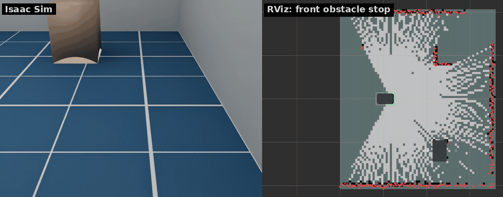
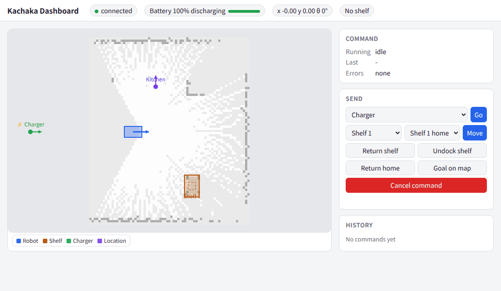
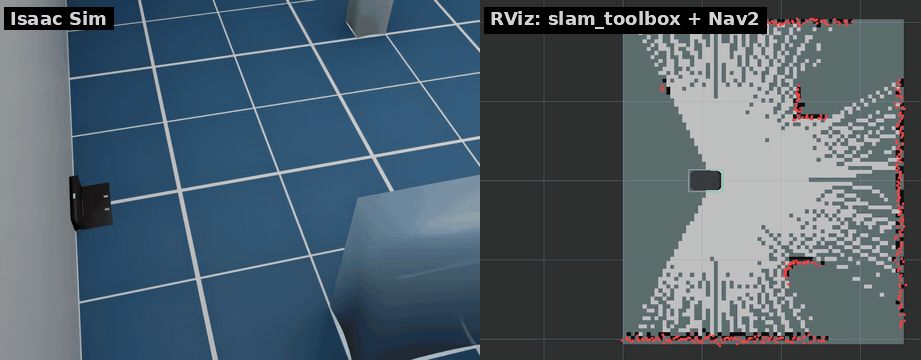
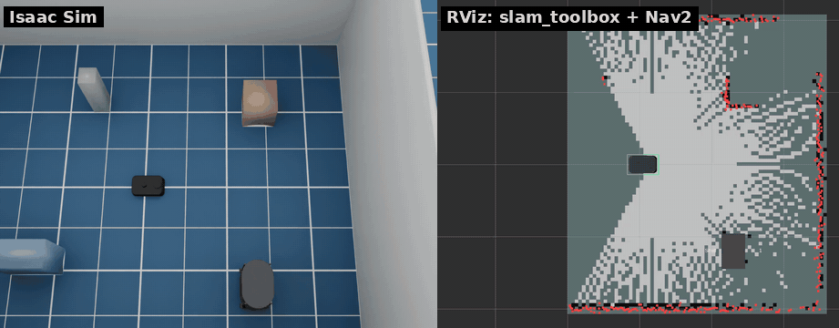
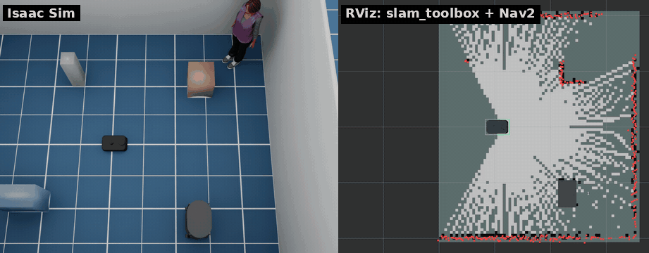
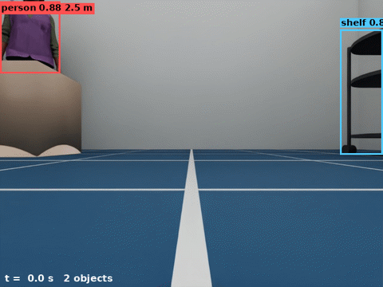
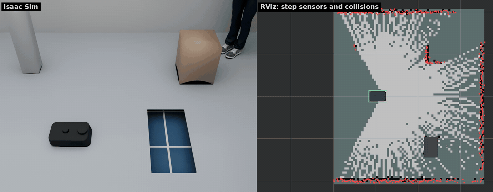

# ロボットの機能

[English](../robot.md) · [README](../../README.ja.md)

## コマンド

```bash
ros2 action send_goal /kachaka/kachaka_command/execute kachaka_interfaces/action/ExecKachakaCommand \
    "{kachaka_command: {command_type: 13, move_to_pose_command_x: 1.0, move_to_pose_command_y: 0.5,
      move_to_pose_command_yaw: 1.57}, cancel_all: true}"   # MOVE_TO_POSE_COMMAND
ros2 topic pub --once /kachaka/goal_pose geometry_msgs/PoseStamped \
    "{header: {frame_id: map}, pose: {position: {x: 1.0, y: 0.5}, orientation: {w: 1.0}}}"
```

| コマンド | 動作 |
|---|---|
| MOVE_TO_POSE | map 座標で Nav2 のゴールを送る |
| MOVE_TO_LOCATION | `layout/locations/list` の場所へ Nav2 で移動。充電器（`home`）なら RETURN_HOME |
| SPEAK | 音声なし。テキストをログと `sim/speech` に出す |
| MOVE_FORWARD、ROTATE_IN_PLACE | オドメトリで距離を進む・角度を回る。MOVE_FORWARD は前方に障害物があると止まる（−9） |
| MOVE_BY_VELOCITY_WITH_MUTED_SENSORS | 指定の速度で指定の時間走る。その間は前方障害物での停止を無効にする |
| LOCK | 指定の時間その場で止まる |
| DOCK_ANY_SHELF_WITH_REGISTRATION | 場所に最も近い（0.5 m 以内の）シェルフにドッキング |
| LOCALIZE | すぐ成功する（シミュレータは自己位置を見失わない） |
| DEPART_FROM_CHARGER | 充電器から 0.3 m 離れる。充電器の上にいなければ失敗（−13） |

実機と同じく、`cancel_all: true` なら実行中のコマンドを止めます。付けなければ前のコマンドが
終わるまで待ちます。`tts_on_success` はコマンド成功後に `sim/speech` に出ます。`goal_pose` は
実機ブリッジと同じく `cancel_all` なしで MOVE_TO_POSE を送ります。

## 前方障害物での停止



実機のカチャカは、すぐ前に障害物があると自動で止まります（スマホアプリで OFF にできます）。
シミュレータも、teleop・Nav2・`set_robot_velocity`・コマンドのどこから来た速度指令にも同じように効きます。

- 車体の前、幅 0.30 m の範囲の LiDAR の空き距離が `margin + v × スキャン周期 + v² / (2 × 減速度)`
  まで縮むと前進にブレーキをかけます。止まっているときは 3 cm（`front_stop.margin`）空けます。
  旋回と後退はでき、前が空けばまた進みます
- 範囲はシェルフの脚の間隔より狭いので、カチャカシェルフの下には入れます。牽引中のシェルフは見ません
- MOVE_BY_VELOCITY_WITH_MUTED_SENSORS と `mute_sensors` 付きの MOVE_FORWARD は、実行中この停止を
  無効にします。MOVE_FORWARD はこの停止で 1 秒止められると −9 で失敗します
- 初期状態と範囲は `config/robot.yaml`（`front_stop`）で設定します。アプリの設定は kachaka-api に
  ないので、実行中の切り替えはシミュレータ専用のサービス `sim/front_stop/set_enabled` で行います

```bash
ros2 service call /kachaka/sim/front_stop/set_enabled std_srvs/srv/SetBool "{data: false}"
ros2 topic echo /kachaka/sim/front_stop/state   # {"enabled": false, "muted": false, "blocked": false}
```

実機の停止距離と範囲は公開されていないので、値は推定です。LiDAR の高さは 10.5 cm なので、
それより低い障害物は見えません。

## トーチライト


kachaka-api には前と後ろのトーチライトがあり、`SetFrontTorchIntensity` /
`SetBackTorchIntensity`（0〜255、0 で消灯）で明るさを変えます。実機のどこに付いているかは
公開されておらず、URDF にもフレームがありません。シミュレータではカメラを照らすものと仮定し、
前後カメラの位置にカメラの向きのスポットライトを置いています。Python クライアントにはラッパーがないので、
gRPC のスタブを直接呼びます。

```python
from kachaka_api import KachakaApiClient
from kachaka_api.generated import kachaka_api_pb2 as pb2

client = KachakaApiClient("127.0.0.1:26400")
client.stub.SetFrontTorchIntensity(pb2.SetFrontTorchIntensityRequest(intensity=255))
```

- 実機には明るさを読み出す RPC がありません。シミュレータは `sim/torch`（latched の JSON
  `{"front", "back"}`）に出します
- 既定のシーンは明るいので、トーチの効果はほとんど見えません。`--dome-light 0` で
  デフォルトの部屋の環境光を消せます（Isaac Sim のシーンは独自の照明を持っています）
- 明るさ・照射角・色は推定です（`config/robot.yaml` の `torch`）

## シミュレータのリセット

シミュレータ専用のサービス `sim/reset` で、シミュレータを再起動せずに開始時の状態へ戻せます。



```bash
ros2 service call /kachaka/sim/reset std_srvs/srv/SetBool "{data: false}"   # data: true なら SLAM の地図も消す
```

- ロボットはスポーン位置に静止状態で戻ります。牽引中のシェルフは切り離し、すべてのシェルフをホームに戻します
- オドメトリはスポーン位置へのジャンプを誤差なしの移動として扱うので、SLAM の地図と map フレームはそのまま使えます。
  `data: true` のときは slam_toolbox が地図を作り直し、オドメトリもゼロから始め直します
- バッテリーは初期値に戻り、トーチは消え、緊急停止は解除され、前方障害物停止は
  `config/robot.yaml` の設定に戻ります
- `command_server` は実行中・待機中のコマンドを結果を出さずに破棄し、コストマップを消去して、
  パラメータの設定（自動充電）に戻ります
- gRPC サーバはコマンド履歴・最後の結果・エラー・追加した音声・スピーカー音量を初期化します。
  `navigation.launch.py` のときは AMCL にロボットが開始位置に戻ったことを伝えます
- リセット後 1 秒間は `cmd_vel` を無視します。まだ指令を送っているコントローラがロボットを
  動かしてしまわないようにするためです

`tests/` の ROS チェックは最初にリセットします（`--no-reset` で省略、`--clear-map` で地図も消去）。
`python3 /tests/sim_reset.py` 単体でもリセットできます。

## 充電器に戻る



*RETURN_HOME（2 倍速）。Nav2 で充電器の前まで走り、実機と同じく後ろ向きに充電器へ乗ります。*

```bash
ros2 action send_goal /kachaka/kachaka_command/execute kachaka_interfaces/action/ExecKachakaCommand \
    "{kachaka_command: {command_type: 8}}"   # RETURN_HOME_COMMAND
```

Nav2 を含む ROS 2 スタック（`NAV=true ... up slam` または `up navigation`）が必要です。
`command_server` もその中で起動します。充電器から離れるには Nav2 のゴールを送るだけです。
充電器の寸法は推定値です（`config/robot.yaml`）。

## バッテリー

バッテリー残量はロボットの消費電力から計算します（`config/robot.yaml` の `battery`）。

- **充電器の外**: 常にかかる待機分（電子回路・センサー・コンピューター）と、車輪の回転速度と
  駆動トルクから求める走行分の和。シェルフ運搬中は走行分が増えます。既定値では停止中が約 20 %/h、
  0.3 m/s で約 40 %/h、シェルフを運びながら 0.3 m/s で約 60 %/h です（シミュレーション時間）。
- **充電器の上**: 80 % までは 100 %/h の定電流、その後は定電圧で、残りに比例して遅くなります
  （80 % から満充電まで約 50 分）。
- **`robot_info/battery_state`** には電圧（残量と電圧の対応表から）、電流（放電中は負）、
  充電量、容量、一定の温度も入ります。実機のブリッジは残量と充電状態だけ（電圧は −1）で、
  `battery.bridge_fields_only: true` で同じになります。

数値はすべて実機で測るまでの推定値です（#4）。

## シェルフの運搬



*DOCK_SHELF のあと MOVE_SHELF で別の場所へ運び、UNDOCK_SHELF で離れる（3 倍速）。*



*続けて RETURN_SHELF：置いたシェルフはコストマップに全体が載る（LiDAR に映るのは脚だけ）ので、Nav2 はそれを避けて経路を引く。*

部屋にはカチャカシェルフが 1 台（`S01`、ホーム `S01_home`）と、ほかの場所が 1 つ（`L01`）あります。
ロボットは前進でシェルフの下に入り、ピンを上げてキャスター付きのシェルフを牽引します
（最高 0.5 m/s、[速度上限](#速度上限)）。
牽引中は Nav2 のフットプリントがシェルフの大きさになります。
アンドックではピンを下げて前進でシェルフから抜けます。前がふさがっているときは失敗します。

```bash
ros2 action send_goal /kachaka/kachaka_command/execute kachaka_interfaces/action/ExecKachakaCommand \
    "{kachaka_command: {command_type: 1, move_shelf_command_target_shelf_id: S01,
      move_shelf_command_destination_location_id: L01, move_shelf_command_undock_on_destination: true}}"   # MOVE_SHELF_COMMAND
```

| コマンド | 動作 |
|---|---|
| DOCK_SHELF | ロボットの前（1.5 m 以内）にあるシェルフとドッキング |
| UNDOCK_SHELF | 牽引中のシェルフを置いて前進で抜ける |
| MOVE_SHELF | 必要ならドッキングし、指定の場所まで運ぶ。アンドックは任意 |
| RETURN_SHELF | シェルフのホームまで運んでアンドック |
| RETURN_HOME | 牽引中ならシェルフをホームに戻してから充電器へ |

シェルフは `layout/shelves/list`、ホームは `layout/locations/list` に載ります。
`--shelf X Y YAW` でシェルフを置けます。シェルフは SLAM 上の場所に置かれるので、
ワールド上では数 cm ずれます。
`robot_description` は実機と同じくロボット単体です。RViz では `shelf_markers` ノードが配信する
`/shelf_markers`（MarkerArray）でシェルフを表示します。

## 速度上限

| | 単体 | シェルフ牽引中 |
|---|---|---|
| 手動: `manual_control/cmd_vel`、`set_robot_velocity` | 0.3 m/s | 0.3 m/s *（仮定）* |
| 自律: Nav2、kachaka-api のコマンド（`sim/autonomous/cmd_vel`） | 0.8 m/s *（推定）* | 0.5 m/s *（推定）* |
| 旋回（両方） | 1.57 rad/s | 1.57 rad/s（Nav2: 0.98 rad/s） |


実機のブリッジは手動の cmd_vel を 0.3 m/s・1.57 rad/s にスケールします。カチャカの仕様の最高速度は
単体 0.8 m/s、シェルフ付き 0.5 m/s で、実機で測るまで（#4）シミュレータは自律走行にこの値を使います。
実機が牽引中に手動の上限も下げるかは分かっていません（牽引時の 0.5 m/s はどのみち 0.3 m/s より上です）。

自律走行の指令はシミュレータ専用の topic `sim/autonomous/cmd_vel` で届きます。`nav_bridge` は
`use_sim_time` が true のとき Nav2 の `/cmd_vel` をここへ転送し（実機では `manual_control/cmd_vel`）、
`command_server` は MOVE_FORWARD や ROTATE_IN_PLACE などをこの topic で動かします。
`manual_control/cmd_vel` に出した指令は誰からでも 0.3 m/s のままです。シェルフをドックしている間は
`command_server` が Nav2 のコントローラに 0.5 m/s の `speed_limit` を送り（MPPI は旋回速度も同じ比率で下げ、
1.57 → 0.98 rad/s）、アンドックで解除します。上限は `config/robot.yaml` の `drive.max_linear_vel`、
`drive.max_linear_vel_auto`、`drive.max_linear_vel_towing` で、`tests/speed_limit_check.py` が測ります。

## 物体検出



*`scripts/detection_demo.py`: その場で 1 回転し、`GetObjectDetection` と前方カメラの画像から描画。*

実機は前方カメラの画像を検出ネットワークにかけます。シミュレータは代わりにレンダラーから物体を取ります。
各ピクセルのインスタンス ID と距離から、どの人・シェルフ・充電器が映っているかがわかります。
物体は見えているピクセルだけから検出するので、人の手前に箱があれば、実際の検出器と同じく
人の枠はその分だけ小さくなります。

- `roi`: 見えているピクセルを囲む枠。前方カメラの画素単位（640×480）で、±2 px のノイズ付き
- `distance_median`: 見えているピクセルの距離の中央値
- `score`: 見えている面積が大きいほど高い（150 px で 0.5、20000 px 以上で 0.95）。少しノイズ付き
- 5 m より遠いものと 150 px より小さいものは検出しません。各フレームで 2 % の物体を見逃します
- 結果は前方カメラの画像ごと（10 Hz）に出て、画像と同じタイムスタンプが付きます

実機の検出距離・スコア・見逃し率は公開されていないので、これらの値は推定です
（`config/robot.yaml` の `object_detection`）。ドアは検出しません。

`GetObjectDetectionFeatures` は前方カメラの画像ごとに、実機の検出器と同じ形の特徴マップを返します。
[kachaka-transfer-learning](https://github.com/pf-robotics/kachaka-transfer-learning)
で学習する `predictor.onnx` の入力で、`p4_out`（1×96×14×25）、`p5_out`（1×96×7×13）、
`p6_out`（1×96×4×7）です。実機のネットワークは公開されていないので、別のネットワークで作ります。
画像を 224×398 に縮小して torchvision の ImageNet 学習済み MobileNetV3-Large に通し、
ストライド 16 と 32 のブロックを固定の乱数 1×1 畳み込みで 96 チャンネルにし、`p6_out` は
ストライド 2 の max pool です（`kachaka_isaac_sim/detection_features.py`）。名前はデモノートブックが
`_out` を外して ONNX の入力名にしていることからの推定です。シミュレータの特徴量で学習したヘッドは
シミュレータでは動きますが実機では動きません（逆も同じ）。初回の呼び出しで重み（22 MB）を
torch hub のキャッシュにダウンロードします。`config/robot.yaml` の `api.detection_features: false`
で特徴量を止められます（以前と同じく空）。

部屋には人が 2 人います（`config/robot.yaml` の `people.room`）。Isaac Sim 同梱のキャラクター
（`people.characters`、腕を下ろして立ったまま）です。アセットサーバーに届かないときはカプセルの人形に
なります。`--person X Y YAW` で人を置き、`--no-people` でなくせます。Isaac Sim のシーンには既定では人はいません。

LiDAR と Nav2 には人のコライダーが見えます（[`legs.py`](../../kachaka_isaac_sim/legs.py)）。太もも・すねごとの
カプセル（太さ 0.13 m、推定）と、0.75 m より上の上半身を覆う見えない箱（0.28 × 0.5 m）です。LiDAR は床から
0.105 m の高さを走査するので、人は 0.2 m 離れた 2 つの小さな弧（すね）として映ります。歩いている人の脚は
歩容に合わせて振れ、弧が前後に入れ替わり、振り出し中に浮いた脚は一瞬スキャンから消えます。大きさは
`people.height` に比例します。


結果は `GetObjectDetection` と、実機ブリッジと同じ ROS 2 の topic
`/kachaka/object_detection/result`（`kachaka_interfaces/ObjectDetectionListStamped`）に出ます。
シミュレータは `sim/object_detection` に JSON を出し、`bridge.launch.py` の
`object_detection_relay` がそれを変換します。

## 段差と衝突

実機のカチャカは前方に段差センサーを 2 つ持っています。床が見えなくなると停止してコマンドを
キャンセルし、電源ボタンが押されるまでエラー **21052「段差を検知」** と **21051「一時停止中」**
で一時停止します。シミュレータも同じように動きます。

- 前キャスターのすぐ前から下向きのレイを 2 本飛ばし、物理ステップごと（120 Hz）に床を確認します
  （位置と検出距離は推定。`config/robot.yaml` の `cliff`）。
- 新しく段差を見つけると車輪をすぐ止め、全コマンドをキャンセルし、速度指令を無視します。
  `GetError` は `[21051, 21052]` を返し、新しいコマンドは 21051 で失敗します。
- 電源ボタンは `sim/power_button`（`std_srvs/Trigger`）です。kachaka-api の `RestartRobot` と
  `sim/reset` でも復帰します。センサーがまだ段差の上にある間は前進だけを止め、後退と旋回はできます。



標準のワールドは平らです。`--drop X Y SX SY` で (X, Y) を中心に SX × SY m の穴を床に開けます
（深さ 0.15 m、`drop.depth`）。複数指定できます。

```bash
scripts/run_sim.sh --drop 1.0 0.0 0.4 0.8   # スポーン位置の 0.8 m 東に段差
ros2 topic echo /kachaka/sim/cliff          # {"enabled": true, "paused": true, "over": [true, true]}
ros2 topic echo /kachaka/sim/errors         # [21051, 21052]
ros2 service call /kachaka/sim/power_button std_srvs/srv/Trigger
```

実機のバンパーは公表されていないため、既定では衝突しても止まりません。本体（車輪・キャスター・床を除く）
の PhysX 接触レポートを数え、衝突ごとに `sim/collision` へ `{"stamp", "count", "with", "pose"}`
を出します（シナリオの評価指標などに）。同じ物体との接触は、0.5 秒離れてから再び数えます。
`collision.stop: true` にすると段差と同じように停止し、電源ボタンまでシミュレータのエラー −18 を
出します（推定の挙動）。`sim/reset` で回数は 0 に戻ります。
