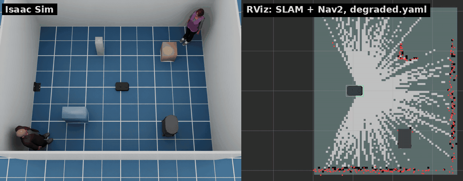
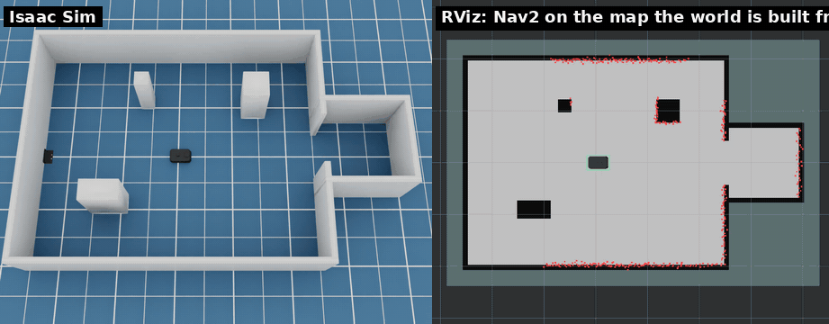

# シミュレータのオプション

[English](../simulator_options.md) · [README](../../README.ja.md)

```bash
scripts/run_sim.sh --world office        # Isaac Sim のシーン: office, hospital, warehouse, simple_room
scripts/run_sim.sh --world /path/to.usd  # 任意の USD シーン
scripts/run_sim.sh --world map:maps/site.yaml   # 占有格子地図から壁を作る（「地図からワールドを作る」を参照）
scripts/run_sim.sh --x 1.0 --y 0.5 --yaw 1.57
scripts/run_sim.sh --layout layouts/room.yaml   # レイアウトファイル（--layout-seed N）、レイアウトファイルの節を参照
scripts/run_sim.sh --no-cameras          # LiDAR とオドメトリだけでよいとき（速い）
scripts/run_sim.sh --dome-light 0        # 暗いシーン（環境光。既定 800）。トーチを見たいときなど
scripts/run_sim.sh --render-hz 20        # 描画・カメラのループ周期（「性能」を参照）
scripts/run_sim.sh --charger X Y YAW     # 充電器の位置（既定: 部屋の西の壁際）
scripts/run_sim.sh --no-charger
scripts/run_sim.sh --shelf X Y YAW       # シェルフを置く（複数可。デフォルトは部屋に 1 台）
scripts/run_sim.sh --no-shelves
scripts/run_sim.sh --person X Y YAW      # 人を置く（複数可。デフォルトは部屋に 2 人）
scripts/run_sim.sh --no-people
scripts/run_sim.sh --drop X Y SX SY      # 床に穴を開ける（複数可。「段差と衝突」を参照）
scripts/run_sim.sh --wall X0 Y0 X1 Y1    # 壁（複数可。「ドア」を参照）
scripts/run_sim.sh --door X Y YAW        # ドア（複数可。--door-kind、--door-width、--door-closed、--door-cycle、--door-auto）
scripts/run_sim.sh --api-port 26400      # kachaka-api の gRPC ポート（既定 26400。0 で無効）
scripts/run_sim.sh --config config/degraded.yaml   # センサーを劣化させる（「センサーの劣化」を参照）
scripts/run_sim.sh --help
```

ロボットのパラメータ（速度上限、センサーの解像度と周期、ノイズ）は
[`config/robot.yaml`](../../config/robot.yaml) にあります。Preferred Robotics が公開していない値には
*(est.)* と書いてあります。設定ファイルは `base` で別のファイルを指定し、変える
キーだけを書くこともできます（`config/degraded.yaml` がその例です）。

## センサーの劣化



既定ではセンサーはほぼ理想的です。`config/robot.yaml` の `degradation` で
センサーを悪くして、SLAM・AMCL・Nav2 がどこまで耐えるかを試せます。既定ではすべて
無効で、値は試験用のつまみであり、実機の測定値ではありません。

| センサー | キー | 効果 |
|---|---|---|
| LiDAR | `invisible`、`dark`、`dark_range` | 透過するプリム（ガラス）、近くでしか見えないプリム（黒い面）のパスのパターン |
| | `dropout`、`noise_per_m` | 何も返さないレイ、距離に比例して増えるノイズ |
| オドメトリ | `slip_areas` | オドメトリ（fused とホイール）が動きの `1 + slip` 倍を読む床の長方形 |
| | `distance_scale_error`、`turn_scale_error` | 全域のスケール誤差 |
| カメラ | `noise`、`exposure_jitter`、`exposure_time` | 画素ノイズ、ゆらぐ露出、旋回中の水平ブレ（前後の RGB） |
| IMU | `gyro_bias(_walk)`、`accel_bias(_walk)` | 起動時に決まり、その後ゆらぐバイアス。ジャイロ z のバイアスは姿勢も回す |

LiDAR は衝突形状を見るので、`invisible` と `dark` は材質ではなくプリムを指定します
（`["/World/Room/Glass*"]`）。オドメトリのランダムなドリフトを増やすには
`odometry.fused_noise_*` を大きくします。[`config/degraded.yaml`](../../config/degraded.yaml)
はほとんどを有効にします:

```bash
scripts/run_sim.sh --config config/degraded.yaml --person 0.0 1.0 0.0
python3 /tests/ros_degradation_check.py   # ROS 2 コンテナで: それぞれの効果が出ているか
```

## Isaac Sim のシーン

Isaac Sim のシーンは NVIDIA のアセットサーバーから読み込み、初回以降はローカルのキャッシュを使います。
シーンごとに床の空いた場所に既定のスポーン位置があり、`--x`、`--y`、`--yaw` を省略するとそこに置きます
（`room`、`empty`、USD のパスでは 0）。SLAM の map 座標系の原点はスポーン位置です。

| `--world` | スポーン (x, y, yaw) | 初回読み込み | 起動（キャッシュ後） | 実時間比（カメラあり / `--no-cameras`） |
|---|---|---|---|---|
| `office` | 0, 0, 1.5708（ロビー、北向き） | 数分 | 22 秒 | 1.2 / 1.9 |
| `hospital` | 0, 0, 0（病棟の南のロビー） | 7 分 | 21 秒 | 1.3 / 2.0 |
| `warehouse` | −13, 11, 1.5708（ラックの間の通路） | — | 40 秒 | 1.2 / 1.9 |
| `simple_room` | −2.5, 0, 0（テーブルの横） | 数秒 | 15 秒 | 1.4 / 2.0 |

初回読み込みでは Isaac Sim のアセットサーバーからシーンを取得します。起動時間は、アセットがキャッシュされた状態で起動してから `[kachaka] running` が出るまでです。実時間比はシミュレーション時間 / 実時間で、`--realtime 0`、ロボット静止、RTX 2080 Ti での値です。デフォルトの `--realtime 1` では 1 で頭打ちになります。

`tests/ros_nav_check.py --world <名前>` で、各シーンのルートを SLAM と Nav2 で走らせて確認できます。シーンの注意点:

- **低い家具・細い家具。** LiDAR は床から 10.5 cm の 1 平面だけを測り、Nav2 はそこに見えるものしか知りません。
  simple_room のテーブルの脚（高さ 5 cm の板）、hospital の椅子の脚、office の机の脚は小さな点になるか、まったく映りません。
  こうした家具は避けるルートにしてください。
- **LiDAR の到達距離より長い空間。** 10 m 以内で反射のない光線は地図に残らないため、長い廊下やホールの中央は未知領域になります。
  NavFn は 8 m ほどの未知領域を越える経路を作れません。遠いゴールはテストのルートのように経由点を挟んでください。
- **ドアの段差。** office の y = 12 と y = 24 の出入口には 4〜5 mm の段差があります。ロボットは 6 mm 程度までの段差を越えられます。
  車体は剛体なので、前側が乗り上げるときの傾きの上限を後輪キャスターと床の 6 mm のすき間が決めます（車体の箱と床のすき間は 8 mm）。
  Preferred Robotics は段差の上限を公表しておらず、段差のない床を推奨しています。
- office の**ガラス扉**は開いた状態で、枠には当たり判定があります。
- **warehouse のラック**は LiDAR の高さでは脚しか映らないため、コストマップ上は壁ではなく柱の列になり、
  Nav2 が棚の下の脚の間を通ろうとすることがあります。テストは 1 本の通路（x = −13）の中だけを走ります。
  ラックの北のホール（y > 25）は通路から LiDAR が届かず、近づくまで地図に載りません。

## 地図からワールドを作る



`--world map:<パス>` は占有格子地図から壁を作ります。実際の現場をすばやく再現したいときに使います。
読める地図は、Nav2 の地図（`map_saver_cli` の yaml。解像度・原点・しきい値もそのまま使います）、
カチャカの PNG 書き出し、その他の画像（暗い所が障害物、明るい所が空き。`--map-resolution` で 1 ピクセルあたりの m を指定。
原点は左下の角）です。

```bash
scripts/run_sim.sh --world map:maps/site.yaml
scripts/run_sim.sh --world map:floor_plan.png --map-resolution 0.05 --x 2 --y 3
ros2 launch kachaka_sim_bringup navigation.launch.py map:=/maps/site.yaml
```

- 障害物のセルは高さ `map_world.wall_height`（1 m。`--map-wall-height` で変更）の壁になります。
  セルはできるだけ少ない箱にまとめ、1 つのメッシュとして作ります。空きと未知のセルは床です。
- ワールド座標系は地図の座標系と同じです。地図の原点にスポーンすれば（既定）、同じ地図の `navigation.launch.py` がすぐに自己位置を合わせ、
  地図上でクリックしたゴールがそのままワールドの位置になります。別の位置に置くときは `--x`/`--y`/`--yaw` を地図の座標で指定します。
  スポーン位置が壁の上なら警告を出します。
- 充電器は yaml の `charger_pose`（`make_maps.py` やシミュレータの地図書き出しが書く値）に置きます。
  `--charger` か `--no-charger` を指定すればそちらが優先です。
- すべての障害物が壁と同じ高さになります。地図には机や棚、段差の情報がないためです。箱やドア、人はレイアウトファイルで足してください。

`tests/ros_map_world_check.py` は地図から作ったワールドを確かめます。AMCL の位置が真値と合うこと、LiDAR の点が地図の壁に乗ること、
充電器が `charger_pose` にあること、Nav2 がゴールまで何にも触れずに着くことです（`smoke_test.sh --nav` がエレベータのレイアウトの 1 階の地図で実行します）。
