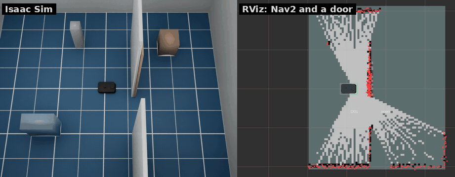
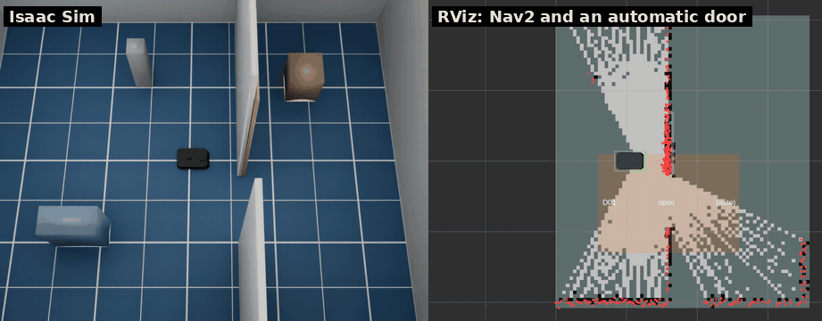
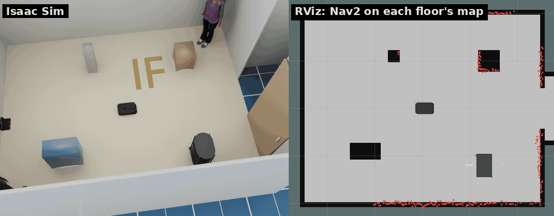
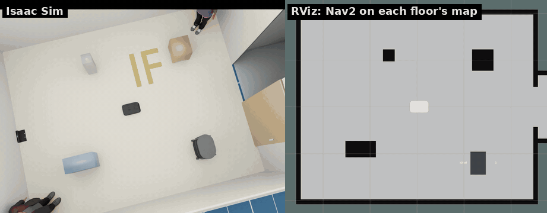
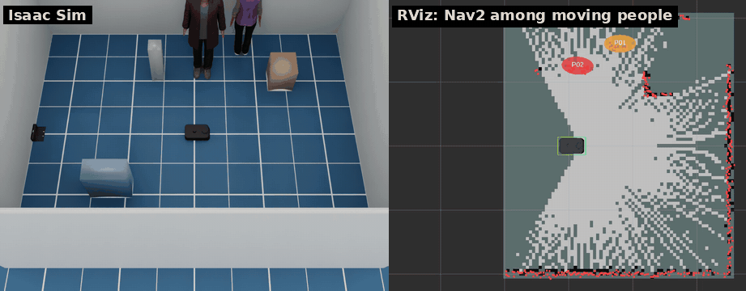

# ワールドとレイアウト

[English](../worlds.md) · [README](../../README.ja.md)

## ドア

`--door X Y YAW` で (X, Y) を中心とする出入口にドアを置きます。出入口は YAW の向き（壁に沿って x）です。
出入口の両側の壁は別に `--wall X0 Y0 X1 Y1` で足します（どちらも複数可）。ドアはキネマティックな板で、
LiDAR に映り、閉じている間は Nav2 がコストマップに載せて迂回します。進路にあるものは押しのけます
（安全センサーで止まりません）。



- `--door-kind sliding|hinged`（`door.kind`）: 引き戸は壁に沿って動き、開き戸は出入口の −x 側を軸に 90° 回ります。
- `--door-width`（0.8 m）、`--door-closed`（閉じた状態で開始）、`--door-cycle OPEN_S CLOSED_S`
  （最初のコマンドまで一定周期で開閉）。速さ・厚さ・高さは `config/robot.yaml` の `door` にあります。
- ドアは指定順に D01、D02、... と名付けます。`sim/doors/<id>/set_open`（`std_srvs/SetBool`）で開閉し、
  `sim/doors`（latched の JSON）に各ドアの `id`、`kind`、`pose`（map 座標系）、`width`、
  `state`（open、closed、opening、closing）、`opening`（0〜1）、`cycling`、`panel`（パネル中心の
  map 座標系の `pose` と `size` [長さ, 厚さ, 高さ]）を出します。状態が変わったときと、パネルが
  動いている間は 0.1 秒ごとに配信します。`sim/reset` でドアは開始時の状態に戻ります。
- RViz では `door_markers` ノードが `sim/doors` から配信する `/door_markers`（MarkerArray）で
  パネルを表示します。閉は紫、開閉中は黄色、開は薄い灰色で、id と状態付きです（[RViz の色](../../README.ja.md#rviz-の色)）。

**自動ドア**（#63）は、オフィス・店舗・病院によくあるように自分で開きます。レイアウトのドアに
`auto: true` を付けるか、`--door` のドアに `--door-auto` を付けます。自動ドアは引き戸で、出入口の両側に
センサ範囲があります。範囲は壁に沿って `width + 2 * margin`、両側にそれぞれ奥行き `range` の長方形です。
範囲内にロボット（真値）または動く人・箱（[動く人と箱](#動く人と箱)）がいる間は開き、範囲が空いてから
`hold` 秒後に閉まります。閉まる途中で何かが入ると開き直します。



- 設定は `config/robot.yaml` の `door.auto` です。`range` 1.0 m、`margin` 0.3 m、`hold` 2.0 秒
  （実際のドアセンサ（マイクロ波・赤外線）は製品ごとに違うため、いずれも仮定値）と `movers`
  （true なら動く人や箱でも開く）。レイアウトのドアごとに上書きできます:
  `auto: {range: 1.5, hold: 3.0, movers: false}`。
- 自動ドアは開き戸にできず、`cycle` も付けられません。
- `sim/doors/<id>/set_open` で強制的に開閉できます。その後は `sim/reset` までセンサを無視します。
  `sim/doors` には `auto`（センサがドアを動かしている間 true）と、自動ドアなら `sensor`
  （出入口を中心とする範囲の `size` [壁に沿って, 壁を横切って]）が入ります。
- RViz ではセンサ範囲を床の薄いオレンジの長方形で表示し、ドアのラベルに「(auto)」を付けます。
- Nav2 には閉じた自動ドアも他のドアと同じ障害物に見えるので、離れた所からはそこを通る経路を作れません。
  通り道がその出入口だけなら、ドアが開くほど近づくまで向こう側のゴールは失敗することがあります（未検証）。
  `tests/ros_auto_door_check.py` のように、まずドアの前まで行かせてください。

```bash
# x = 0.6 の壁、y = -0.6 にドア、北端にすき間（layouts/room_door.yaml）
scripts/run_sim.sh --no-shelves --no-people --wall 0.6 -2.0 0.6 -1.0 --wall 0.6 -0.2 0.6 1.2 --door 0.6 -0.6 1.5708
scripts/run_sim.sh --layout layouts/room_door.yaml   # 同じ
ros2 service call /kachaka/sim/doors/D01/set_open std_srvs/srv/SetBool "{data: false}"
ros2 topic echo /kachaka/sim/doors   # {"doors": [{"id": "D01", "state": "closing", ...}]}
# 同じ壁ですき間なし、自動ドア（layouts/room_auto_door.yaml）
scripts/run_sim.sh --layout layouts/room_auto_door.yaml
```

## エレベーター

レイアウトに `floors` と `elevator` があると、部屋をフロアごとに x 方向へ 10 m ずつずらして並べ
（フロア k の座標は 1 階の座標 + k × 10 m）、どのフロアにも壁の出入口の奥に同じかごを置きます。
かごにはフロアごとに引き戸があります。`sim/elevator/go`（`std_msgs/String`、フロア名）でかごを呼ぶと、
ドアが閉まり、1 フロアあたり `ride` 秒待ってから、かごの中のもの（ロボット、シェルフ）を行き先フロアの
かごへ移し、そこでドアが開きます。オドメトリはこの移動を見ません。ロボットが出入口にいる間は
ドアセンサーのように開き直します。`sim/elevator`（latched の JSON）に `floors`、`floor`（かごの階）、
`target`、`state`（open、closing、riding、opening）、`door`、`robot_floor`、`robot_in_car` を出します。
`sim/reset` でかごは開始階に戻ります。フロアごとに床の色を変え、床にフロア名を描いています
（見た目だけで、センサーには映りません）。乗ったことがビューポートで分かります。



```bash
python3 scripts/make_maps.py layouts/elevator.yaml   # maps/elevator_1F.yaml, maps/elevator_2F.yaml
scripts/run_sim.sh --layout layouts/elevator.yaml
ros2 launch kachaka_sim_bringup navigation.launch.py map:=/maps/elevator_1F.yaml
ros2 topic pub --once /kachaka/sim/elevator/go std_msgs/msg/String "{data: 2F}"
ros2 topic echo /kachaka/sim/elevator   # {"floor": "2F", "state": "open", "robot_floor": "2F", ...}
```

フロアごとに別の保存地図で走ります。`scripts/make_maps.py` がレイアウトから地図を描きます（壁、かご、
動かない箱。ドアは開いた状態）。各フロアの map 座標系は開始位置をそのフロアへずらしたものなので、
かごの中の位置はどのフロアの地図でも同じ座標です。乗った後は次のフロアの地図を読み込みます。
そのとき乗る前の map 上の位置（TF の `map` → `base_footprint`。`/amcl_pose` は 0.25 m か 0.2 rad
動いたときしか出ないので遅れることがあります）を一緒に渡します（kachaka-api の `SwitchMap` の `initial_pose`、
または `sim/map/load` の `"pose"`）。command_server は地図を読み込み、AMCL にその位置を与え、
向きまで合ったのを確かめてから応答します（AMCL は新しい地図で初期化し直すので、別に送った
`/initialpose` は失われることがあります）。`tests/ros_elevator_check.py` は 1 階でかごに入り、2 階へ移動し、
地図を切り替えて 2 階のゴールまで走ります。

実機がどう乗るかは建物側の仕組みによります。三菱電機ビルソリューションズと Preferred Robotics の実証では、
カチャカが建物のプラットフォーム（Ville-feuille）に依頼し、Ville-feuille がかごを呼んで行き先階を登録し、
乗るかごと乗り降りのタイミングをカチャカに伝えます
（[プレスリリース、2024-09-28](https://www.excite.co.jp/news/article/Prtimes_2024-09-28-115855-30/)）。
戸田建設の TODA BUILDING では、同社が公開 API で作ったシステムでカチャカプロがエレベーターを使い
フロア間で郵便物を運んでいます（[LOGISTICS TODAY、2026-07-17](https://www.logi-today.com/978771)）。
kachaka-api にはエレベーターの呼び出しがないため `sim/elevator/go` はシミュレータ専用で、かごの大きさ
（1.4 × 1.4 m）、ドア（0.9 m）、時間は推定です（`config/robot.yaml` の `elevator`）。

### フロアを縦に積む

`elevator` に `stack: vertical` を書くと、フロアを 3 m（推定）ずつ縦に積み、かごの床を台にして
ロボット（とシェルフ）を昇降路に沿って運びます。テレポートはしません。レイアウトの書き方は同じ
（フロア k は x + k × 10 m）なので同じ保存地図が使え、各フロアの map 座標系は同じ x, y の開始位置です。
`sim/elevator` には `stack` と `robot_z`（1 階からの高さ）が加わります。上の階にはドアと動く人・箱を
置けません。かごの向きは 90° の倍数にします。



```bash
python3 scripts/make_maps.py layouts/elevator.yaml
scripts/run_sim.sh --layout layouts/elevator_vertical.yaml
ros2 launch kachaka_sim_bringup navigation.launch.py map:=/maps/elevator_1F.yaml
```

## レイアウトファイル

`--layout FILE` で YAML ファイルを読み、ロボットの開始位置と、充電器・シェルフ・
ロケーション・人・箱・壁・ドア・段差の配置をワールドに重ねます。どのワールドとも
組み合わせられます。例は [`layouts/`](../../layouts) にあります: `room.yaml`、
`room_door.yaml` と `room_auto_door.yaml`（上のドアの構成）、`room_movers.yaml`（[動く人と箱](#動く人と箱)）、Isaac Sim のシーン用の `office.yaml`、
`hospital.yaml`、`warehouse.yaml`、`simple_room.yaml`。


```yaml
world: room                 # --world が優先
seed: 7                     # 下の範囲指定用
clearance: 0.15             # ランダム配置の物体どうしの間隔 [m]（既定 0.1）
spawn: [0.0, 0.0, 0.0]      # x, y, yaw (m, rad)
charger: [-2.27, 0.0, 0.0]  # null なら充電器なし
shelves:
  - {id: S01, name: Shelf 1, pose: [1.3, -1.2, 0.0]}
  - {id: S02, name: Shelf 2, pose: [[0.6, 2.0], [0.3, 1.5], [-0.3, 0.3]]}  # 範囲指定
locations:
  - {id: L01, name: Kitchen, pose: [0.5, 1.0, 1.5708]}
people: [[2.0, 1.5, -2.5]]
boxes:
  - {name: crate, pose: [0.2, -1.6, 0.4], size: [0.5, 0.35, 0.45], color: [0.45, 0.55, 0.35]}
walls: [[0.6, -2.0, 0.6, -1.0]]              # x0, y0, x1, y1
doors:
  - {pose: [0.6, -0.6, 1.5708], kind: sliding, width: 0.8, open: true, cycle: [10, 5]}
  - {pose: [0.6, 1.0, 1.5708], auto: true}    # 自動ドア: ロボットが近づくと開く
drops: [[1.0, 0.0, 0.4, 0.8]]                # x, y, x 方向の大きさ, y 方向の大きさ
```

- 書かなかったキーはワールドの既定のまま（部屋には充電器、シェルフ 1 台、ロケーション 1 つ、
  人 2 人）。書いたキーは置き換えるので、`shelves: []` ならシェルフなし、`charger: null`
  なら充電器なしです。
- 姿勢のどの数値も範囲 `[lo, hi]` にでき、シードで値を引きます。ランダム配置の物体は
  他の物体（部屋ではその壁も）から `clearance` 離れるまで引き直します。`--layout-seed N`
  はファイルのシードより優先し、どちらもなければシードを選んで表示します
  （`[kachaka] layout layouts/room.yaml (seed 7)`）。同じ配置を再現できます。
- シェルフとロケーションは kachaka-api（`GetShelves`、`GetLocations`）とダッシュボードに
  渡るので、`MOVE_TO_LOCATION` やシェルフのコマンドで使えます。
- コマンドラインのオプションも効きます。`--shelf`、`--charger`、`--person`、`--no-*`、
  `--x/--y/--yaw` はレイアウトの値を置き換え、`--wall`、`--door`、`--drop` は追加します。
- 起動後、各物体がシーンと重なっていないかを調べ、壁や家具にめり込んでいれば
  `[kachaka] layout warning: ...` を表示します。

```bash
scripts/run_sim.sh --layout layouts/room.yaml --layout-seed 3
scripts/run_sim.sh --layout layouts/office.yaml   # --world office にもなる
```

## 動く人と箱

レイアウトファイルの人と箱は動かせます。動くものはキネマティックな剛体で、物理ステップごとに
動かすので、LiDAR・カメラ・ToF カメラ・物体検出にはその時の位置で見えます。レイアウトで
指定しない限り何も動きません。例は [`layouts/room_movers.yaml`](../../layouts/room_movers.yaml) です。



```yaml
people:
  - {pose: [0.8, -1.6, 1.5708], route: [[0.8, 1.6]], pause: 2.0}   # 往復
  - {pose: [0.0, 1.2, 0.0], wander: [[-0.1, 0.2], [0.6, 1.6]], speed: 0.5}  # x の範囲, y の範囲
boxes:
  - {name: cart, pose: [-1.6, -0.3, 0.0], size: [0.5, 0.4, 0.8],
     route: [[-0.5, -0.3]], speed: 0.3, pause: 3.0, appear: [25, 8]}
```

- `route`: 経由点を順に歩き、開始位置に戻るのを繰り返します。
  `wander`: 範囲内のランダムな点へ歩きます（レイアウトのシードで引きます）。両方は指定できません。
- `speed`（m/s。既定は `config/robot.yaml` の `movers.person_speed` 0.7 と
  `movers.box_speed` 0.4）、`pause`（経由点ごとに止まる秒数）、`appear: [いる, いない]`
  （秒。しばらくいて、いなくなる。周期のどこから始まるかはシードで引きます）。
- 次の経由点の方を向いてから歩きます。ロボットが行く手のすぐ先にいる間は待ち、ロボットの
  真上には現れません。`movers.give_way` 秒（3）待つと直前の経由点へ引き返すか、別の場所へ
  ぶらつきに行きます（人がすぐそばにいるとロボットが離れられないことがあるため）。それ以外では
  止まらないので、ロボットの側でよける必要があります。
- 人は歩くときに脚（脚のコライダーも）を、キャラクターは腕も振ります。
- `sim/reset` で開始位置に戻ります。
- 正解位置は `sim/movers`（シミュレータのみ、ground truth と同じ 20 Hz）に出ます。JSON で、
  動くものごとに `id`、`path`（USD プリム）、`kind`（`person` か `box`）、`present`、
  `pose` [x, y, yaw]（world 座標系、`sim/ground_truth` と同じ）と `map_pose`（map 座標系。
  いない間はどちらも `null`）、`velocity` [vx, vy]（world 座標系）、`radius`（占有半径）、
  `size` [x, y, z]、`blocked`（ロボット待ち）、`gap`（占有円とロボット本体の間の距離 m）、
  最後にロボットに一番近いもの `closest` が入ります。ドアは含みません（`sim/doors`、[ドア](#ドア)）。
- RViz では `mover_markers` ノードが `sim/movers` から配信する `/mover_markers`（MarkerArray）で
  表示します。人は円柱、箱は箱で、名前と速度の矢印付き、ロボット待ちの間は赤です。

```bash
scripts/run_sim.sh --layout layouts/room_movers.yaml
python3 /tests/ros_nav_check.py --no-collisions   # SLAM + Nav2 と一緒に: ゴール到達、衝突なし、最接近距離
ros2 topic echo /kachaka/sim/movers   # {"stamp": 12.3, "frame_id": "world", "movers": [...], "closest": {"id": "P01", "gap": 0.41}}
```
