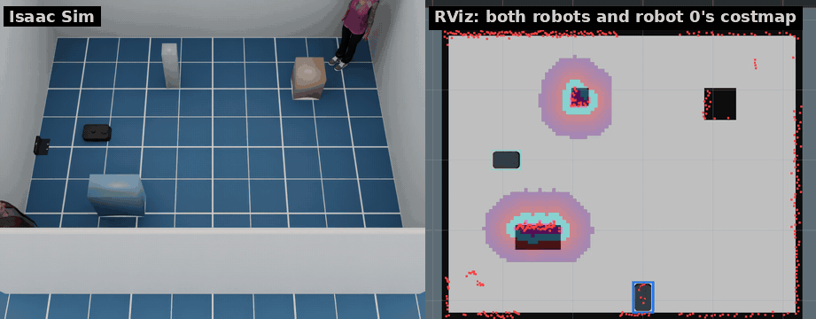

# Several robots

[日本語](ja/multi_robot.md) · [README](../README.md)

One simulator can run several Kachakas in the same world. Each has its own
ROS 2 namespace, TF frames and kachaka-api port, and they all share one map
frame. `fleet.launch.py` starts Nav2 for each robot on a saved map. Each robot
sees the others in its LiDAR scan and keeps their footprints in its costmaps.



*Two robots on one map, their paths crossing (`scripts/record_demo.sh fleet`).*

## Quick start

Two robots in the default room, navigating on a shared map. Run the
`python3` and `ros2` commands in the ROS 2 container
(`docker compose -f docker/compose.yaml run --rm shell`).

```bash
# 1. The room's map, with the map frame at robot 0's spawn pose (maps/room.yaml)
python3 scripts/make_maps.py --spawn -1.7 0.2 0

# 2. The simulator with two robots (on the host)
scripts/run_sim.sh --no-cameras --no-shelves --robot -1.7 0.2 0 --robot 0.3 -1.8 1.5708

# 3. Nav2 for both robots, with robot 1's start in the map frame
ros2 launch kachaka_sim_bringup fleet.launch.py map:=/maps/room.yaml robots:=2 initial_poses:=2.0,-2.0,1.5708

# 4. Send robot 1 a goal
ros2 action send_goal /kachaka_1/navigate_to_pose nav2_msgs/action/NavigateToPose \
    '{pose: {header: {frame_id: map}, pose: {position: {x: 2.0, y: 0.5}, orientation: {z: 0.7071, w: 0.7071}}}}'
```

The simulator prints a line for each extra robot before it is ready:

```
[kachaka] robot 1: ROS namespace '/kachaka_1', frames 'kachaka_1/...', start (2.000, -2.000, 1.571) in the map frame, kachaka-api on port 26401
[kachaka] running: ROS namespace '/kachaka', world 'room', charger at (-2.27, 0.0, 0.0), kachaka-api on port 26400
```

The `start` it prints is the value to pass to `initial_poses`.

## Placing the robots

`--robot X Y YAW` adds one robot, in the world frame, and can be repeated. It
replaces `--x`, `--y` and `--yaw`. The first `--robot` is robot 0, the next
robot 1, and so on. Layouts with an elevator take one robot only.

## Names

Robot 0 keeps the single-robot names, so code written for one robot works on
it unchanged. Robot i (1, 2, …) gets the suffix `_i`:

| | Robot 0 | Robot i |
|---|---|---|
| Prim | `/World/kachaka` | `/World/kachaka_i` |
| Topics | `/kachaka/...` | `/kachaka_i/...` |
| TF frames | `odom`, `base_footprint`, … | `kachaka_i/odom`, `kachaka_i/base_footprint`, … |
| Nav2 (with `fleet.launch.py`) | `/navigate_to_pose`, `/initialpose`, … | `/kachaka_i/navigate_to_pose`, `/kachaka_i/initialpose`, … |
| kachaka-api | `--api-port` (26400) | `--api-port` + i (26401, …) |
| Noise seed | `--seed` | `--seed` + 1000 i |

All robots share one `/clock`, one `/tf` and one map frame, whose origin is
robot 0's spawn pose.

## Navigation

`fleet.launch.py map:=<yaml> robots:=N` starts `navigation.launch.py` for
robot 0 (with RViz and robot 0's command, charger and shelf servers) and
`robot_nav.launch.py` under `/kachaka_i` for each other robot. Each robot
gets its own AMCL, planner and controller, with `nav2_params.yaml` rewritten
for its frames and topics.

| Argument | Default | |
|---|---|---|
| `map` | | the map YAML, shared by all robots |
| `robots` | 2 | how many robots the simulator runs |
| `initial_poses` | | `x,y,yaw` of robots 1, 2, … in the map frame, in a row |
| `rviz` | true | RViz, with a model for each robot |

- **Starting poses.** Robot 0's AMCL starts at the map origin, its spawn
  pose. `initial_poses` gives the others' starts, so every robot is
  localized, and drawn in RViz, from the start. A robot without one waits
  for a pose on its own `/kachaka_i/initialpose`.
- **The map.** Build it before starting the fleet: `make_maps.py` for the
  room or a layout, or slam_toolbox with robot 0 alone. The map frame must be
  robot 0's spawn pose. There is no launch file for SLAM with several robots.
- **Goals.** RViz's **2D Goal Pose** sends goals to robot 0. Send the others
  goals on their own `navigate_to_pose` action, as in the quick start, or
  from your own nodes.
- **Each other.** The LiDAR sees only 9 cm of another robot's 24 cm body
  (the laser housing sticks up above the body; the rest is lower than the
  scan plane). `fleet_outlines` therefore puts every robot's Nav2 footprint,
  placed with its AMCL pose, into the others' costmaps and collision monitors
  on `{namespace}/other_robots` (yellow outline in RViz, blue 0.5 s ahead).
  The parts of a body at the LiDAR's height (the housing and a bump at the
  back, from a slice of the official body mesh) are intersected with the scan
  in 2D and have no collider, so a shelf's bottom plate (0.107 m) still
  clears the body.
- **No traffic rules.** The Nav2 stacks do not negotiate with each other.
  Two robots that meet nose to nose in a narrow place can block each other
  until their goals abort. Taking turns is a fleet manager's job, outside the simulator.

## kachaka-api per robot

Each robot serves kachaka-api on its own port. Robot 0's API is complete (see
[kachaka-api](kachaka_api.md)). The servers that run commands, shelves and
locations belong to robot 0, so robot i's API covers less:

| On robot i's port | Works |
|---|---|
| Pose and battery (`get_robot_pose`, `get_battery_info`) | yes; the pose is in the shared map frame once `fleet.launch.py` runs, in robot i's odom frame before |
| Manual driving (`set_manual_control_enabled`, `set_robot_velocity`) | yes |
| Commands (`start_command`, `move_to_pose`, `rotate_in_place`, …) | no: error −6, server unavailable |
| Locations and shelves (`get_locations`, `get_shelves`) | no: the call does not return; avoid it |

```python
from kachaka_api import KachakaApiClient

robot1 = KachakaApiClient("127.0.0.1:26401")
print(robot1.get_robot_pose())
```

## What the other robots lack

- No cameras (front, back, ToF) and no object detection.
- No shelves: shelves and their docking belong to robot 0.
- No charger of their own: they share robot 0's.
- `sim/reset` of robot i puts robot i back at its spawn pose. Robot 0's
  reset resets the world as well.

Doors, automatic doors and moving people react to every robot.

## Tests

| | |
|---|---|
| `tests/ros_multi_check.py` | two robots facing each other: separate topics, TF and odometry, each drives on its own commands and sees the other |
| `tests/ros_multi_nav_check.py` | two robots on one map, paths crossing at right angles: both arrive without touching |

`scripts/smoke_test.sh` runs the first, and `smoke_test.sh --nav` runs both.
See the docstrings for the simulator command lines they expect.
