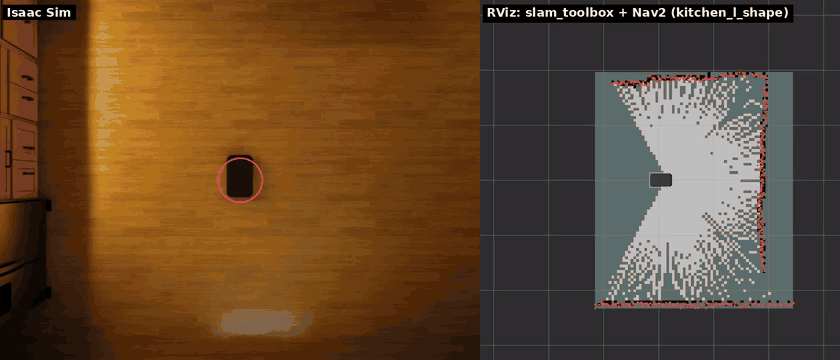

# Simulator options

[日本語](ja/simulator_options.md) · [README](../README.md)

```bash
scripts/run_sim.sh --world office        # Isaac Sim scenes: office, hospital, warehouse, simple_room, kitchen_*
scripts/run_sim.sh --world /path/to.usd  # any USD scene
scripts/run_sim.sh --world map:maps/site.yaml   # walls from an occupancy map, see World from a map
scripts/run_sim.sh --x 1.0 --y 0.5 --yaw 1.57
scripts/run_sim.sh --layout layouts/room.yaml   # a layout file (--layout-seed N), see Layout files
scripts/run_sim.sh --no-cameras          # faster, when you only need LiDAR and odometry
scripts/run_sim.sh --dome-light 0        # dark scene (ambient light, default 800), e.g. to see the torches
scripts/run_sim.sh --render-hz 20        # render/camera loop rate (see Performance)
scripts/run_sim.sh --charger X Y YAW     # place the charger (default: by the west wall of the room)
scripts/run_sim.sh --no-charger
scripts/run_sim.sh --shelf X Y YAW       # place a shelf (repeatable; default: one in the room)
scripts/run_sim.sh --no-shelves
scripts/run_sim.sh --person X Y YAW      # place a person (repeatable; default: two in the room)
scripts/run_sim.sh --no-people
scripts/run_sim.sh --drop X Y SX SY      # a hole in the floor (repeatable), see Steps and collisions
scripts/run_sim.sh --wall X0 Y0 X1 Y1    # a wall segment (repeatable), see Doors
scripts/run_sim.sh --door X Y YAW        # a door (repeatable; --door-kind, --door-width, --door-closed, --door-cycle, --door-auto)
scripts/run_sim.sh --api-port 26400      # kachaka-api gRPC port (default 26400; 0 turns it off)
scripts/run_sim.sh --config config/degraded.yaml   # degraded sensors, see Sensor degradation
scripts/run_sim.sh --robot X Y YAW       # a robot (repeatable; the first is robot 0, instead of --x/--y/--yaw), see Several robots
scripts/run_sim.sh --help
```

Robot parameters (speed limits, sensor resolution and rates, noise) are in
[`config/robot.yaml`](../config/robot.yaml). Values not published by Preferred
Robotics are marked *(est.)*. A config file can name another as its `base`
and give only the keys it changes (as `config/degraded.yaml` does).

## Sensor degradation


The sensors are close to ideal by default. The `degradation` section of
`config/robot.yaml` makes them worse, to see how SLAM, AMCL and Nav2 cope; all
of it is off by default, and the values are test knobs, not measurements of
the real robot:

| Sensor | Keys | Effect |
|---|---|---|
| LiDAR | `invisible`, `dark`, `dark_range` | prim path patterns it sees through (glass), or sees only up close (black surfaces) |
| | `dropout`, `noise_per_m` | rays that return nothing; range noise that grows with range |
| Odometry | `slip_areas` | floor rectangles where the odometry (fused and wheel) reads `1 + slip` times the motion |
| | `distance_scale_error`, `turn_scale_error` | scale errors everywhere |
| Cameras | `noise`, `exposure_jitter`, `exposure_time` | pixel noise, an exposure that wanders, horizontal blur while turning (front and back RGB) |
| IMU | `gyro_bias(_walk)`, `accel_bias(_walk)` | biases drawn at start that then wander; the gyro z bias also turns the orientation |

The LiDAR works from collision shapes, so `invisible` and `dark` name prims
(`["/World/Room/Glass*"]`), not materials. For more random odometry drift
raise `odometry.fused_noise_*`. [`config/degraded.yaml`](../config/degraded.yaml)
turns most of them on:

```bash
scripts/run_sim.sh --config config/degraded.yaml --person 0.0 1.0 0.0
python3 /tests/ros_degradation_check.py   # in the ROS 2 container: each effect shows up
```

## Isaac Sim scenes

Isaac Sim scenes are streamed from NVIDIA's asset server and cached locally
after the first load. Each has a default spawn pose in free floor space;
`--x`, `--y` and `--yaw` default to it (to 0 in `room`, `empty` and USD paths).
The SLAM map frame starts at the spawn pose.

| `--world` | Spawn (x, y, yaw) | First load | Start, cached | RTF, cameras / `--no-cameras` |
|---|---|---|---|---|
| `office` | 0, 0, 1.5708 (lobby, facing north) | minutes | 22 s | 1.2 / 1.9 |
| `hospital` | 0, 0, 0 (lobby south of the wards) | 7 min | 21 s | 1.3 / 2.0 |
| `warehouse` | −13, 11, 1.5708 (in an aisle between racks) | — | 40 s | 1.2 / 1.9 |
| `simple_room` | −2.5, 0, 0 (beside the table) | seconds | 15 s | 1.4 / 2.0 |
| `kitchen_l_shape` | 0.1, −0.4, 1.5708 (mid-room, facing the north counters) | 1 min | 23 s | 1.0 / 1.6 |
| `kitchen_u_shape` | 0, −0.3, 1.5708 (inside the U, facing its base) | 1 min | 26 s | 1.0 / 1.6 |
| `kitchen_g_shape` | −1.2, 0.7, 0 (north of the peninsula) | 1.5 min | 27 s | 1.0 / 1.6 |
| `kitchen_l_island` | 1.4, −1.1, 1.5708 (south-east of the island) | 1 min | 24 s | 1.0 / 1.5 |
| `kitchen_peninsula` | −1.9, 0.5, 0 (west of the peninsula) | 1 min | 26 s | 1.0 / 1.6 |

First load fetches the scene from the Isaac Sim asset server. Start is from
launch to `[kachaka] running` once the assets are cached. RTF is simulated
time over wall time with `--realtime 0` and the robot standing still, on an
RTX 2080 Ti; the default `--realtime 1` caps it at 1.

`tests/ros_nav_check.py --world <name>` drives a route in each of them with
SLAM and Nav2. Things to know about the scenes:

- **Low and thin furniture.** The LiDAR scans one plane 10.5 cm above the
  floor, and Nav2 only knows what it sees there. The 5 cm foot slabs of the
  simple_room table, chair legs in the hospital and desk legs in the office
  appear as small dots or not at all. Plan routes around such furniture.
- **Spaces longer than the LiDAR range.** Rays with no return within 10 m
  leave the middle of long corridors and halls unknown on the map, and NavFn
  fails to plan across about 8 m of unknown space. Send far goals through
  waypoints, as the test routes do.
- **Door sills.** The office doorways at y = 12 and y = 24 have 4–5 mm
  sills. The robot crosses steps up to about 6 mm: its body is rigid, and the
  rear caster's 6 mm gap above the floor sets how far it can tilt while the
  front climbs (the body box clears the floor by 8 mm). Preferred Robotics
  publishes no step limit and recommends barrier-free floors.
- **Glass doors** in the office stand open; their frames are solid.
- **Warehouse racks** show only their legs at the LiDAR height, so the
  costmap sees a row of posts rather than a wall, and Nav2 may route between
  them under the shelves. The test stays in one aisle (x = −13). The hall
  north of the racks (y > 25) is beyond the LiDAR range from the aisle and
  stays off the map until the robot gets closer.
- **Kitchens** (`kitchen_*`, Isaac Sim's replicator kitchens) are closed
  rooms of 4.7–5.9 × 4.2–5.2 m with base cabinets, a fridge and a range along the
  walls, and an island or a peninsula in some. The LiDAR plane falls on the
  cabinets' 18 mm bottom panel (10–11.8 cm) just above the toe kick, so the
  counters show up as walls. Their doors, drawers and appliances are rigid
  bodies on joints; the simulator makes them kinematic, so nothing opens or
  moves when the robot bumps into it (left dynamic, the fridge in
  `kitchen_l_island` slows the simulation to a third of real time). The
  scenes' own physics scene is turned off.



## World from a map


`--world map:<path>` builds walls from an occupancy map, to approximate a
real site quickly: a Nav2 map pair (`map_saver_cli`'s yaml, with its
resolution, origin and thresholds), a Kachaka PNG export or any other image
(dark is occupied, light free; give `--map-resolution`, m per pixel, origin
at the bottom-left corner).

```bash
scripts/run_sim.sh --world map:maps/site.yaml
scripts/run_sim.sh --world map:floor_plan.png --map-resolution 0.05 --x 2 --y 3
ros2 launch kachaka_sim_bringup navigation.launch.py map:=/maps/site.yaml
```

- Occupied cells become walls `map_world.wall_height` high (1 m,
  `--map-wall-height`), merged into as few boxes as the grid allows and
  built as one mesh. Free and unknown cells are floor.
- The world frame is the map frame: spawned at the map origin (the default),
  `navigation.launch.py` on the same map localizes at once (AMCL starts at
  the map origin), and goals clicked on the map are world poses. Give
  `--x`/`--y`/`--yaw` in the map frame elsewhere, and the same pose to AMCL
  on `/initialpose`; the simulator warns when the spawn pose is on a wall.
- The charger stands at the yaml's `charger_pose` (as `make_maps.py` and the
  simulator's map export write it) unless `--charger` or `--no-charger` says
  otherwise.
- Everything is as high as the walls: a map has no tables, shelves or
  thresholds. Add boxes, doors or people with a layout file.

`tests/ros_map_world_check.py` checks a map world: AMCL at the ground truth
pose from the start, the LiDAR's points on the map's walls, the charger at `charger_pose`
and a Nav2 goal reached without touching anything (`smoke_test.sh --nav`
runs it on the elevator layout's first-floor map).
